<!--
  HOLOHACKING — Jornada da Nutricionista com a Paciente (primeiro modelo, outubro de 2026)
  Fonte editável do documento. Gere o HTML/PDF/DOCX com:  python3 scripts/doc-jornada/build.py  &&  node scripts/doc-jornada/pdf.mjs
  Todas as pessoas e dados são fictícios.
-->

HOLOHACKING

<h1 class="titulo-capa">Jornada da Nutricionista com a Paciente</h1>

Do primeiro contato ao acompanhamento longitudinal em Nutrição Holística

Um guia de utilização do HoloHacking ao longo de um ciclo de acompanhamento de até 10 atendimentos

Primeiro modelo · outubro de 2026 · documento em construção

Apresentação

## Para quem é este documento

Este guia é para a nutricionista que acompanha pacientes com o HoloHacking. Ele não é um manual de botões. Ele mostra **como conduzir um acompanhamento de Nutrição Holística usando o HoloHacking**: o que acontece antes da primeira consulta, o que fazer em cada encontro, como o sistema ajuda a organizar a jornada e onde a decisão é sempre da profissional.

Ao longo do texto, cada etapa responde a quatro perguntas: o que a nutricionista faz, o que a paciente faz, o que o sistema faz e o que aquela etapa produz.

O sistema organiza. O método orienta. A tecnologia sugere. A nutricionista interpreta. A nutricionista decide.
<small>A lógica de todo o HoloHacking</small>

## Como ler este documento

Os capítulos seguem a ordem natural de um acompanhamento. As caixas abaixo aparecem em todo o texto e ajudam a separar o que é do sistema, o que é da profissional e o que é da paciente.

Como a etapa acontece no dia a dia do consultório.

O que o HoloHacking registra, calcula ou organiza sozinho.

O que só a nutricionista pode decidir.

O que a paciente vive, entende ou recebe.

Um limite do método que não pode ser esquecido.

O que a etapa deixa registrado.

Para onde a jornada segue.

Algo que **ainda não existe** no produto. Está descrito como experiência desejada, não como função atual.

**Este é o primeiro modelo do documento.** Ele foi escrito a partir de uma auditoria do sistema real (outubro de 2026, pacote metodológico HOLOS-V1 v6). Ele será refinado, condensado e revisado. Todas as pessoas e dados citados são **fictícios**.

# Sumário

[[SUMARIO]]

# O que é o HoloHacking

Um ambiente profissional para a Nutrição Holística: reúne as informações do acompanhamento e transforma dados dispersos numa jornada organizada.

Num acompanhamento de nutrição, as informações chegam de muitos lugares: a conversa, o que a paciente conta antes da consulta, questionários, exercícios de reflexão, acordos, retornos. Sem um lugar para reuni-las, elas se perdem entre anotações, mensagens e memória.

O HoloHacking é esse lugar. Ele guarda a ficha da paciente, os atendimentos, o Mapeamento Holístico, o HOLOSCAN, as ferramentas de Corpo, Mente e Espírito, o Resultado HOLOS, a Conduta, os documentos e o histórico. E faz isso **sem decidir pela nutricionista**.

<b>Organiza</b>o sistema

<b>Orienta</b>o método

<b>Sugere</b>a tecnologia

<b>Interpreta</b>a nutricionista

<b>Decide</b>a nutricionista

## O que o HoloHacking é

- Um **prontuário organizado** da jornada: cada atendimento, cada registro e cada decisão ficam ligados à paciente e à data em que aconteceram.
- Um **método aplicado**: o HOLOSCAN e as ferramentas seguem um pacote metodológico versionado, com regras fixas e iguais para todas as pacientes.
- Um **apoio à leitura profissional**: o sistema mostra onde aprofundar e quais ferramentas o catálogo sugere, sempre como sugestão.
- Um **canal de entrega**: o que a nutricionista escolhe compartilhar vira um Resultado para a paciente, em PDF.

## O que o HoloHacking não é

- Não é um sistema de diagnóstico.
- Não é inteligência artificial que decide tratamento. O HOLOSCAN segue uma regra fixa do método: o resultado depende só das respostas da paciente. Se ela responde diferente, o resultado muda; se as respostas forem exatamente as mesmas, a conta chega sempre ao mesmo resultado, sem sorteio e sem "opinião" do sistema.
- Não substitui a conversa clínica, a avaliação profissional nem o julgamento da nutricionista.
- Não prescreve dieta nem conduta automaticamente.

O HoloHacking não decide pela nutricionista. Ele deixa a decisão dela mais informada e mais bem registrada.

## Os três territórios: Corpo, Mente e Espírito

O método olha a paciente em três territórios. Eles organizam as ferramentas e a Tríade do HOLOSCAN, mas **não são trilhos separados** nem uma sequência obrigatória.

| Território | O que observa | Ferramentas |
|---|---|---|
| **Corpo** | rotina, hábitos, sinais percebidos, capacidade prática de mudar | OQ³ · Linha do Momentum · Mapa da Rotina |
| **Mente** | motivos, crenças, padrões de comportamento e emoção | PQQ (Escada dos Porquês) · Mapa de Crenças Alimentares · Gatilhos & Respostas |
| **Espírito** | sentido, valores, direção, apoio e pertencimento | Mapa do Propósito · Roda Holística da Vida · Carta ao Futuro Eu · Conexão & Pertencimento |

# A jornada em uma página

Do primeiro contato ao novo ciclo: a sequência natural de um acompanhamento no HoloHacking.

<b>Agendamento / entrada</b>A paciente marca a consulta. A nutricionista registra na Agenda.

<b>Cadastro</b>A ficha da paciente é criada. Só o nome é obrigatório.

<b>Mapeamento Holístico</b>A paciente responde pelo celular, sem criar conta.

<b>Revisão pré-consulta</b>A nutricionista lê as respostas antes de encontrar a paciente.

<b>Primeiro atendimento</b>A consulta é aberta no sistema e a conversa começa.

<b>HOLOSCAN</b>O questionário organiza os relatos em cinco sistemas.

<b>Áreas para aprofundar</b>O resultado mostra por onde a investigação pode começar.

<b>Ferramentas</b>O catálogo sugere; a nutricionista escolhe se e quando aplicar.

<b>Leitura profissional</b>A nutricionista registra o que entendeu.

<b>Conduta</b>Objetivo, estratégia, ações e acordos da etapa.

<b>Resultado para a paciente</b>O que foi entendido e combinado, em linguagem humana.

<b>Acompanhamento</b>A paciente experimenta os acordos no dia a dia.

<b>Retornos</b>Cada encontro revisa, aprofunda ou ajusta.

<b>Evolução</b>O histórico mostra o caminho percorrido, lado a lado.

<b>Novo ciclo ou conclusão</b>A nutricionista decide como seguir.

A sequência é a ordem mais comum, não uma regra. Uma paciente pode chegar sem Mapeamento, uma consulta pode não ter HOLOSCAN, uma ferramenta pode esperar. **A nutricionista conduz; o sistema acompanha.**

## Cada etapa em poucas palavras

| Etapa | O que acontece | Onde fica no HoloHacking |
|---|---|---|
| Agendamento | A consulta é marcada com tipo (Primeira consulta, Retorno, Reavaliação HOLOSCAN, Online) e duração. | Agenda |
| Cadastro | Nome (obrigatório), nascimento, telefone, e-mail, sexo, início do acompanhamento, queixa principal. | Pacientes → Cadastrar paciente |
| Mapeamento Holístico | Link individual, válido por 7 dias, enviado pelo WhatsApp. | Ficha → Mapeamento Holístico |
| Revisão pré-consulta | Leitura das respostas da paciente, que chegam à ficha. | Ficha → Mapeamento Holístico |
| Primeiro atendimento | "Iniciar atendimento" (na Agenda) ou "Novo atendimento" (na ficha). | Ficha → Atendimento ativo |
| HOLOSCAN | Questionário respondido na consulta; o sistema calcula e salva. | HOLOSCAN |
| Áreas para aprofundar | "Por onde investigar": os dois sistemas de nota mais baixa. | Resultado do HOLOSCAN |
| Ferramentas | "Próximos Passos HOLOS": uma ferramenta principal e até duas complementares. | Corpo, Mente, Espírito |
| Leitura profissional | Interpretação do HOLOSCAN, leitura de cada ferramenta, observações do Resultado. | HOLOSCAN, ferramentas, Resultado HOLOS |
| Conduta | Objetivo, estratégia, ações, recursos, orientações, retorno e acordos. | Ficha → Conduta |
| Resultado para a paciente | Resultado HOLOS (visão da paciente) e Resultado Final emitido, em PDF. | Resultado HOLOS e Resultado |
| Retornos e evolução | Novo atendimento, Mapeamento de retorno, revisão de acordos, comparação lado a lado. | Ficha → Atendimentos, Conduta, Evolução |

<figure>
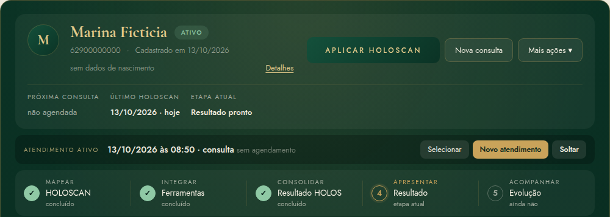
<figcaption><b>O que a nutricionista vê</b> A ficha da paciente fictícia Marina: botão "Aplicar HOLOSCAN", próxima consulta, último HOLOSCAN, etapa atual, atendimento ativo e a faixa da jornada clínica (Mapear, Integrar, Consolidar, Apresentar, Acompanhar), marcada só a partir de dados reais.</figcaption>
</figure>

# Antes da primeira consulta

A preparação começa antes de a paciente entrar no consultório. Bem feita, ela devolve tempo à conversa.

## Passo a passo

1. **A paciente agenda.** A nutricionista registra a consulta na Agenda, com o tipo "Primeira consulta".
2. **A nutricionista cadastra a paciente.** Só o nome é obrigatório; o resto pode ser completado depois. O telefone é o que permite enviar o Mapeamento pelo WhatsApp.
3. **O sistema cria a ficha.** Ela já nasce com a faixa da jornada vazia, pronta para ser preenchida pelos registros reais.
4. **A nutricionista gera o Mapeamento Holístico.** Na aba "Mapeamento Holístico", o botão "Enviar Mapeamento Holístico" cria um link individual, válido por 7 dias.
5. **Envia o link pelo WhatsApp.** O botão "Enviar pelo WhatsApp" abre a conversa com a paciente já com a mensagem pronta. Também é possível copiar o link.
6. **A paciente abre o link no celular, sem criar conta e sem senha.**
7. **A paciente responde.** As respostas são salvas sozinhas; ela pode parar e continuar depois pelo mesmo link.
8. **A paciente envia.** Depois de enviado, o Mapeamento não pode mais ser alterado pelo link.
9. **As respostas chegam ao HoloHacking.** O cartão muda para "Concluído" e mostra "Mapeamento recebido".
10. **A nutricionista revisa antes da consulta.** Ela lê as respostas, organizadas por etapa.
11. **Na consulta, leva as informações para o atendimento.** Com o atendimento aberto, o botão "Levar para o atendimento" transforma as respostas num rascunho do Mapeamento profissional daquele atendimento.

- Quando enviar o Mapeamento (e se vale enviar).
- O que perguntar a partir das respostas.
- O que levar para o atendimento e o que corrigir no rascunho.

- Recebe uma mensagem pessoal da nutricionista.
- Responde no próprio tempo, pelo celular, em poucos minutos.
- Chega à consulta já tendo pensado sobre o que a trouxe.

- Gera um link individual e seguro, com validade de 7 dias.
- Salva as respostas automaticamente enquanto a paciente preenche.
- Mostra o estado do convite: Não enviado, Enviado, Iniciado, Concluído, Expirado ou Revogado.

Um retrato inicial, **relatado pela própria paciente**, pronto para orientar a primeira conversa. Não é diagnóstico nem conclusão.

<figure>
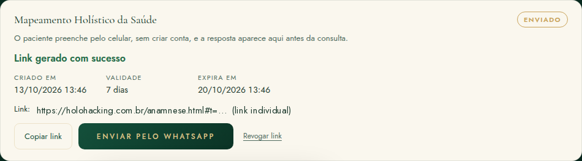
<figcaption><b>O que acontece nesta etapa</b> O link é gerado com validade de 7 dias. Ele aparece só neste momento; para reenviar, gera-se um link novo, que substitui o anterior.</figcaption>
</figure>

A mensagem que o sistema prepara para o WhatsApp diz: *"Olá, [primeiro nome]. Antes da nossa consulta, peço que preencha o seu Mapeamento Holístico da Saúde pelo link abaixo: [link]. As informações serão utilizadas para preparar seu atendimento."* A nutricionista pode ajustar o texto antes de enviar.

# Mapeamento Holístico

Um formulário curto que a paciente responde antes da consulta. Ele prepara o atendimento e organiza o que ela relata. Não é diagnóstico nem ferramenta terapêutica.

## Finalidade

O Mapeamento Holístico da Saúde reúne, antes do primeiro encontro, o que a paciente busca, como come, o que percebe no corpo, como está a sua saúde, a sua rotina e o seu momento de vida. Com isso, a nutricionista chega à consulta sabendo por onde começar e usa o tempo do encontro para escutar e aprofundar, não para preencher formulário.

## Diferença entre Mapeamento e HOLOSCAN

| | Mapeamento Holístico | HOLOSCAN |
|---|---|---|
| Quando | Antes da consulta (e nos retornos) | Dentro do atendimento |
| Quem responde | A paciente, sozinha, pelo celular | A paciente, com a nutricionista |
| Para quê | Preparar a consulta e registrar o contexto | Organizar relatos em cinco sistemas, segundo o método |
| Gera nota? | Não | Sim: notas por sistema, Índice HOLOS e Tríade |
| Sugere ferramenta? | Não | Sim, pelo catálogo (PP-V1) |

## Como é o formulário da paciente

O formulário de primeira consulta foi pensado para levar poucos minutos e é quase todo de toque, com perguntas de escolha. Nada é obrigatório, e a paciente pode responder "Prefiro não responder" nas questões sensíveis. **Peso e medidas não são pedidos à paciente.**

<b>1 · O que te traz aqui</b>Motivo do acompanhamento, o que mais gostaria de melhorar, experiências anteriores com nutrição.

<b>2 · Alimentação e sinais</b>Padrão alimentar, até três dificuldades, fome, sinais percebidos no corpo, o que mais incomoda, água.

<b>3 · Saúde e cuidados</b>Condições já informadas por profissionais, cirurgias, medicamentos, suplementos, alergias, intolerâncias.

<b>4 · Sono, hábitos e rotina</b>Horários de sono, previsibilidade da rotina, trabalho, atividade física, álcool, tabaco, o que dificulta e o que ajuda.

<b>5 · Seu momento atual</b>Opcional: mudanças recentes, apoio, algo pessoal que queira contar.

<b>6 · Revisar e enviar</b>Resumo das respostas e um espaço livre final.

<figure>
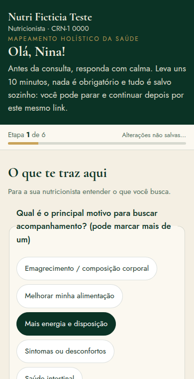
<figcaption><b>O que a paciente vê</b> A primeira etapa do Mapeamento no celular (paciente fictícia). As respostas são salvas sozinhas e a paciente pode continuar depois pelo mesmo link.</figcaption>
</figure>

## Como as respostas chegam

Quando a paciente envia, a aba "Mapeamento Holístico" da ficha mostra o cartão "Concluído" e as respostas organizadas por etapa, com a data do envio. O sistema avisa: *"Como o paciente respondeu — nada aqui é diagnóstico nem conclusão."* Os botões são "Ver resposta" / "Esconder resposta", "Levar para o atendimento" e "Enviar novo Mapeamento". Mapeamentos anteriores ficam guardados em "Mapeamentos anteriores".

<figure>
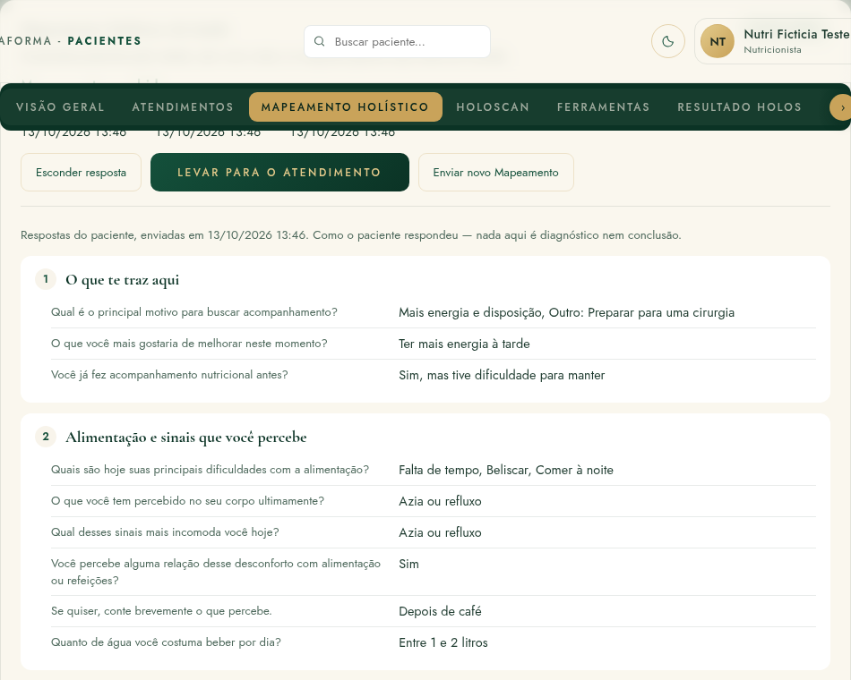
<figcaption><b>O que a nutricionista vê</b> As respostas recebidas na ficha, antes da consulta (paciente fictícia).</figcaption>
</figure>

## "Levar para o atendimento"

Na consulta, com o atendimento aberto, "Levar para o atendimento" transforma as respostas da paciente num **rascunho** do Mapeamento profissional daquele atendimento, marcado como "relato da paciente". A nutricionista revisa, completa com o que ouviu na conversa e conclui. A resposta original da paciente não é alterada.

- Só funciona com um atendimento ativo, e só se aquele atendimento ainda não tiver Mapeamento.
- O Mapeamento profissional tem salvamento automático enquanto é escrito e, depois de concluído, não é editado: uma correção vira uma **nova revisão**.
- O Mapeamento profissional tem blocos para motivo e objetivo, história e rotina alimentar, saúde e sintomas, medicamentos e restrições, estilo de vida, histórico e contexto, e avaliação objetiva (preenchida pela nutricionista).

## Mapeamento de retorno

Quando a paciente já tem um Mapeamento profissional concluído, o próximo link enviado é automaticamente o de **retorno**: uma etapa só, "Desde a última consulta" (o que melhorou ou piorou, o quanto conseguiu colocar em prática, o que ajudou e o que dificultou, mudanças, medicamentos, algo novo), mais a revisão.

<figure>
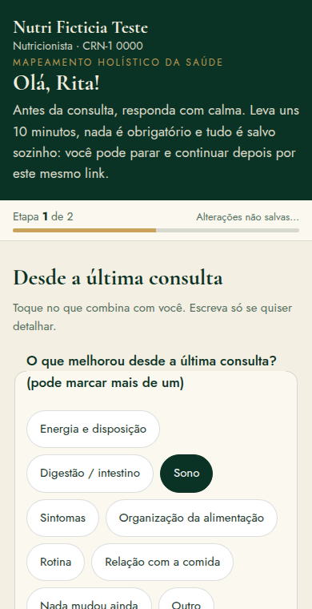
<figcaption><b>O que a paciente vê</b> O Mapeamento de retorno, mais curto, enviado antes de um retorno (paciente fictícia).</figcaption>
</figure>

## O que o Mapeamento não faz

- Não diagnostica nem conclui. Tudo o que está ali é **relato da paciente**.
- Não gera nota, não alimenta o HOLOSCAN e não escolhe ferramenta.
- Não é ferramenta terapêutica: ele prepara a conversa, não a substitui.

# A primeira consulta

O encontro em que a jornada ganha um ponto de partida. A nutricionista escuta, organiza e combina o primeiro passo.

## O fluxo do encontro

1. **Abrir o atendimento.** Pela Agenda ("Iniciar atendimento") ou pela ficha ("Novo atendimento"). Agendamento não é atendimento: o atendimento clínico só existe depois desse passo. Com ele ativo, o Mapeamento profissional, o HOLOSCAN e a Conduta ficam ligados àquele encontro.
2. **Revisar o contexto.** O Mapeamento recebido, a queixa principal e o que a paciente trouxe.
3. **Conversar.** O Mapeamento prepara a conversa; não a substitui.
4. **Levar o Mapeamento para o atendimento**, revisar e concluir o registro profissional.
5. **Aplicar o HOLOSCAN, quando pertinente.** A nutricionista decide se é o momento.
6. **Revisar o resultado do método.** Os cinco sistemas, o Índice, a Tríade e "Por onde investigar".
7. **Identificar as primeiras áreas para aprofundar**, à luz da conversa.
8. **Escolher uma ferramenta pertinente**, se fizer sentido, entre as sugeridas pelo catálogo.
9. **Aplicar a ferramenta** e registrar a leitura profissional.
10. **Construir a Conduta**: objetivo da etapa, estratégia, ações e acordos.
11. **Preparar o Resultado HOLOS** e escolher o que compartilhar com a paciente.
12. **Emitir o Resultado Final**, quando for o momento, e enviar o PDF.

**O HOLOSCAN não substitui a conversa clínica.** Ele organiza relatos segundo o método; a escuta, o contexto e o julgamento profissional continuam sendo o centro da consulta.

- Se aplica o HOLOSCAN nesta consulta.
- Se concorda com a ordem das áreas ou se a conversa pede outra prioridade.
- Se aplica uma ferramenta agora, depois ou não aplica.
- O que entra na Conduta e o que é compartilhado com a paciente.

- Um atendimento registrado, com data e hora.
- O Mapeamento profissional, um HOLOSCAN salvo e, se houver, uma ferramenta concluída.
- Uma Conduta com acordos.
- Um Resultado HOLOS e, quando emitido, um Resultado Final em PDF.

Nem tudo precisa acontecer no primeiro encontro. Em consultas curtas, é comum aplicar o HOLOSCAN e construir uma Conduta simples, deixando a primeira ferramenta para o retorno. O sistema não exige ordem nem completude.

# HOLOSCAN

O HOLOSCAN é o questionário estruturado do método. Ele organiza o que a paciente relata em cinco sistemas e ajuda a decidir por onde começar a conversa. Ele não é diagnóstico, não é exame e não é inteligência artificial: é uma regra fixa do método. O resultado depende só das respostas; respostas iguais levam sempre ao mesmo cálculo, e respostas diferentes mostram um momento diferente.

## O que é, em uma frase

O HOLOSCAN organiza relatos. Não diagnostica.
<small>Princípio do método</small>

O HOLOSCAN é aplicado dentro de um atendimento, com a paciente. As perguntas são curtas, sobre o que ela percebe no dia a dia, e cada resposta é escolhida numa escala de quatro pontos:

| Tipo de pergunta | Opções de resposta |
|---|---|
| Frequência | Nunca · Às vezes · Frequente · Sempre |
| Intensidade | Nada · Um pouco · Bastante · Muito |

Na versão vigente do pacote metodológico (**HOLOS-V1 v6**, publicada em 13/10/2026), o questionário tem **81 perguntas**. Destas, **69 pontuam** em algum sistema e **12 são só de contexto**: ficam registradas para a nutricionista, mas não entram em nenhuma nota.

- Mostra as perguntas do pacote vigente, com o botão **Aplicar HOLOSCAN** (sem mostrar a quantidade de perguntas para a paciente).
- Calcula as notas dos cinco sistemas, o Índice HOLOS e a Tríade a partir das respostas, sempre com a mesma regra.
- Grava a aplicação junto com a versão do pacote usada, para que o histórico continue legível quando o método evoluir.

## Como é aplicado

Na ficha, o botão "Aplicar HOLOSCAN" leva à seção HOLOSCAN, onde a paciente responde às perguntas, organizadas em três blocos: raízes físicas, padrões emocionais e propósito, valores e fé. Cada toque fica salvo no aparelho. Ao final, "Gerar o mapa" calcula o resultado e "Salvar HOLOSCAN" grava a aplicação no servidor, ligada ao atendimento ativo.

<figure>
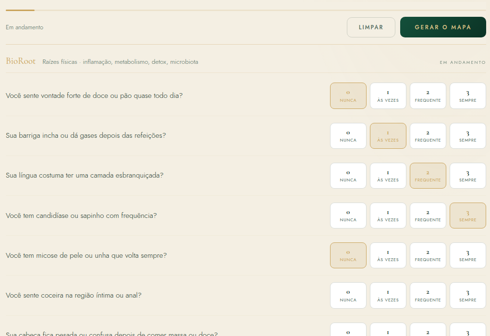
<figcaption><b>O que acontece nesta etapa</b> O questionário em andamento. A paciente vê só as perguntas e a escala; a quantidade de perguntas não é mostrada.</figcaption>
</figure>

Cada reaplicação começa do zero: nada é preenchido com respostas antigas. **Não existe intervalo automático para reaplicar.** A reaplicação é decisão profissional e contextual, até que uma regra oficial de periodicidade seja definida.

## Os cinco sistemas

Os sistemas são **categorias autorais do método**. Cada um reúne um grupo de relatos. Nenhum deles mede órgão, função, substância ou doença.

### Sistema Fúngico
Organiza relatos digestivos e alimentares (vontade de doce ou pão, inchaço e gases depois de comer, mal-estar com comida gordurosa, cabeça pesada depois de massa ou doce) e relatos de mucosas e couro cabeludo. **Não é detector de fungo**: não diagnostica candidíase, infecção fúngica nem disbiose. Pontuam 8 perguntas.

### Sistema Ácido Inflamatório
Organiza relatos de dor, rigidez, desconforto e reatividade percebida: dor articular sem esforço, corpo travado ao acordar, azia, dor de cabeça frequente, gengiva que sangra, piora percebida com ultraprocessados. **Não mede inflamação nem pH**: "ácido" é nomenclatura do método. Pontuam 8 perguntas.

### Sistema Metabólico
Organiza relatos de energia, fome, saciedade, comportamento alimentar e refeições: sono depois do almoço, fome pouco depois de comer, acordar cansada, perceber (ou não) fome e saciedade, começar a comer sem pausa. **Não diagnostica** resistência à insulina, diabetes, alterações da tireoide ou outras condições metabólicas. Exames não participam do HOLOSCAN. Pontuam 7 perguntas.

### Sistema Detox e Linfático
Organiza relatos de retenção percebida, eliminação e sensibilidade a substâncias: pernas inchadas no fim do dia, rosto inchado ao acordar, intestino preso, reação forte a café, medicamento ou pouca bebida alcoólica, incômodo com cheiros. **Não mede toxinas**, função hepática nem fluxo linfático: "Detox" é nomenclatura do método. Pontuam 6 perguntas.

### Sistema Mental Emocional Espiritual
Organiza relatos de pensamento, emoção, comportamento, autorregulação, identidade, conexão, valores e sentido: cabeça que não desliga, preocupação, comer para se acalmar, autocrítica, limites, mágoa, culpa depois de comer, direção e propósito. **Não diagnostica transtorno mental** e não mede saúde, valor ou qualidade espiritual. Pontuam 40 perguntas.

## Nota, Índice HOLOS e Tríade

**Nota do sistema (0 a 10)**

É a posição do sistema dentro da escala do instrumento. Quanto **mais baixa**, mais carga a paciente relatou nas perguntas daquele sistema. Só existe nota quando pelo menos **80%** das perguntas do sistema foram respondidas.

**Índice HOLOS (0 a 100)**

É a média dos cinco sistemas, com o mesmo peso para cada um. Só é calculado quando os cinco sistemas têm nota. **Não é percentual de saúde.**

**Tríade (Corpo · Mente · Espírito)**

Agrupa as perguntas pelo bloco em que aparecem no questionário (36 de Corpo, 19 de Mente e 14 de Espírito). Ajuda a contextualizar; não escolhe ferramenta nem muda a prioridade.

Uma nota baixa **não significa doença, gravidade nem risco**. Uma nota alta **não significa** ausência de doença nem "sistema saudável". A nota é sempre sobre os relatos daquela aplicação, naquele momento.

## Sinais que pontuaram e contexto que não pontua

Em cada sistema, o Resultado mostra **até três sinais** que mais contribuíram para a nota: as perguntas em que a paciente relatou mais carga. Eles ajudam a entender *por que* aquele sistema apareceu, sem afirmar causa.

Algumas perguntas são **só de contexto**. Elas aparecem para a nutricionista num bloco separado, **"Contexto, sem pontuar"**, e não alteram nota, Índice, Tríade, prioridade, sinais nem Próximos Passos. São, por exemplo:

- condições nomeadas pela própria paciente (candidíase, micose, acne, eczema, psoríase);
- histórico (uso de antibiótico ao longo da vida);
- observações corporais que poderiam sugerir diagnóstico (distribuição de gordura, pele escurecida, dificuldade de perder peso, pele opaca, odor do suor, celulite);
- contexto de vida (contato com a natureza, refeições sozinha e com pressa).

O que é contexto informa a conversa. Não vira motivo da nota.

## Áreas para aprofundar

Com as notas calculadas, o sistema ordena os cinco sistemas da **nota mais baixa para a mais alta**. Os dois primeiros são a **1ª e a 2ª área para aprofundar** (em caso de empate, vale a ordem oficial do método).

**Prioridade aqui é prioridade de investigação**, não de gravidade ou de risco. Quando um sistema não teve nenhuma carga (nota 10,0), o Resultado avisa que ele só aparece na lista pela ordem de desempate; a paciente não lê que essa área "aparece para aprofundar".

<figure>
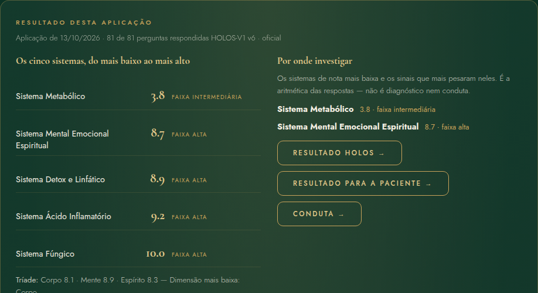
<figcaption><b>O que a nutricionista vê</b> "Resultado desta aplicação" (paciente fictícia Marina): os cinco sistemas do mais baixo ao mais alto, a Tríade e "Por onde investigar". A visão é profissional; a paciente recebe outra, em linguagem simples.</figcaption>
</figure>

A nutricionista lê as áreas **junto com a conversa e o Mapeamento**. Ela pode concordar com a ordem, aprofundar primeiro outra área que a conversa mostrou ser mais importante, ou esperar para decidir. O HOLOSCAN não substitui a conversa clínica.

# Do HOLOSCAN às ferramentas

Como o resultado leva às ferramentas: pelo sistema, pelo catálogo, e sempre com a decisão da nutricionista no meio.

## A lógica: sistema → catálogo → ferramenta

Os Próximos Passos HOLOS (catálogo **PP-V1**, com 30 regras aprovadas) funcionam assim:

Áreas para aprofundar<i>→</i>Sistema<i>→</i>Catálogo PP-V1<i>→</i>Ferramenta sugerida<i>→</i>Decisão da nutricionista

1. O HOLOSCAN mostra a 1ª e a 2ª área para aprofundar.
2. Para cada sistema, o catálogo tem uma lista ordenada de ferramentas que ajudam a aprofundá-lo.
3. O sistema propõe **uma ferramenta principal** (do sistema da 1ª área) e **até duas complementares**, sem repetir ferramenta. As já realizadas naquele atendimento aparecem marcadas.
4. A nutricionista avalia e decide.

A ferramenta é sugerida pelo catálogo para aprofundar este sistema.
<small>Texto que acompanha cada sugestão no sistema</small>

**Nenhuma pergunta isolada escolhe uma ferramenta.** Os sinais que mais pontuaram mostram por que o sistema apareceu como prioridade; a ferramenta vem do catálogo, pelo sistema. Nenhuma ferramenta é obrigatória, e a ordem é uma recomendação, não uma sequência de atendimento.

## O catálogo, sistema a sistema

| Sistema | Ferramentas do catálogo, na ordem de sugestão |
|---|---|
| Fúngico | Mapa da Rotina · Gatilhos & Respostas · Mapa de Crenças Alimentares · Linha do Momentum · OQ³ · Conexão & Pertencimento |
| Ácido Inflamatório | Mapa da Rotina · Linha do Momentum · Gatilhos & Respostas · Roda Holística da Vida · Conexão & Pertencimento · OQ³ |
| Metabólico | Mapa da Rotina · Gatilhos & Respostas · Mapa de Crenças Alimentares · Linha do Momentum · OQ³ · Carta ao Futuro Eu |
| Detox e Linfático | Mapa da Rotina · Linha do Momentum · OQ³ · Roda Holística da Vida · Conexão & Pertencimento · Gatilhos & Respostas |
| Mental Emocional Espiritual | PQQ · Mapa de Crenças Alimentares · Gatilhos & Respostas · Mapa do Propósito · Carta ao Futuro Eu · Conexão & Pertencimento |

<figure>
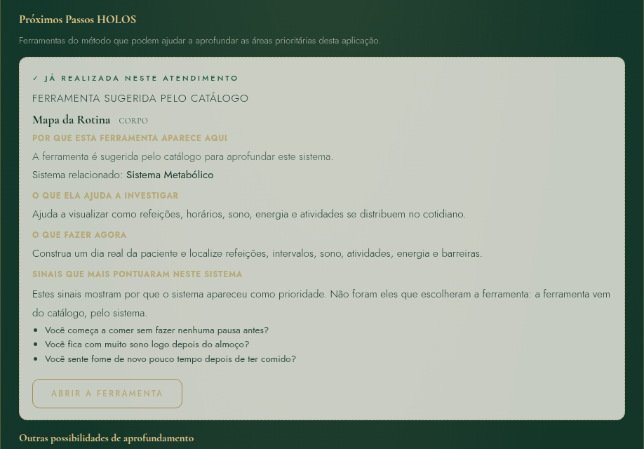
<figcaption><b>O que a nutricionista vê</b> "Próximos Passos HOLOS": cada cartão diz a ferramenta sugerida pelo catálogo, por que ela aparece, o que ajuda a investigar e o que fazer agora. As ferramentas já realizadas no atendimento ficam marcadas (paciente fictícia).</figcaption>
</figure>

## O que a nutricionista considera antes de aplicar

- **A sugestão do catálogo**, como ponto de partida.
- **A conversa**: o que a paciente trouxe pode pedir outra ferramenta ou outro território.
- **O momento da paciente**: energia, tempo e disponibilidade para refletir naquele dia.
- **O que já foi feito**: ferramentas aplicadas antes e o que elas mostraram.

E então decide: aplicar agora, aplicar no retorno ou não aplicar. Seguir, abrir outra ferramenta ou ignorar a sugestão **não altera o Resultado do HOLOSCAN**.

# Ferramentas de Corpo, Mente e Espírito

Dez ferramentas para aprofundar o que o HOLOSCAN e a conversa mostraram. Nenhuma é diagnóstica, nenhuma é obrigatória e nenhuma transforma a nutrição em psicoterapia.

## Como as ferramentas funcionam no HoloHacking

- Cada ferramenta tem um formulário próprio, nas seções **Corpo**, **Mente** e **Espírito** do menu, e aparece também na aba "Ferramentas" da ficha.
- Quando há um atendimento ativo, a aplicação fica ligada a ele.
- Toda ferramenta pode ser aplicada de novo ("Nova aplicação"); as anteriores continuam no histórico. Não há reaplicação automática.
- **Mapa da Rotina, Gatilhos & Respostas e Conexão & Pertencimento** são registros estruturados: depois de concluídos, não são editados (é possível criar "Nova a partir desta").
- Em sete ferramentas há a **leitura profissional**: "O que chamou atenção", "Prioridade" e "Próximo passo".
- O resultado de cada ferramenta mostra "O que apareceu" (descritivo, sem nota) e, quando existe texto aprovado, "O que isso pode mudar no acompanhamento".
- O que a paciente vê é escolhido no Resultado HOLOS, ferramenta por ferramenta ("Mostrar ao paciente").

<figure>
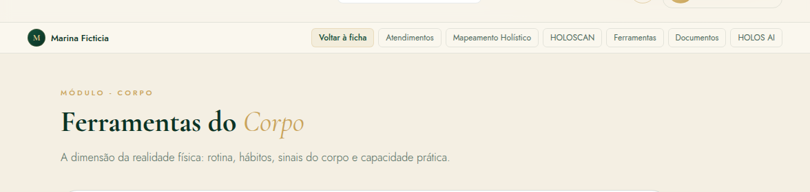
<figcaption><b>O que a nutricionista vê</b> As ferramentas do Corpo, com o estado de cada uma para a paciente ativa: disponível, concluída ou revisada (paciente fictícia).</figcaption>
</figure>

Corpo

## Corpo: a realidade prática

<b>OQ³ — O Que Quer, Precisa, Consegue</b>Corpo · 01

<dl>
<dt>Finalidade</dt><dd>Clareza entre desejo, necessidade e capacidade prática da paciente neste momento.</dd>
<dt>Quando é útil</dt><dd>No início do acompanhamento, ou quando há muitos pontos possíveis de trabalho e é preciso escolher um foco realista.</dd>
<dt>Como funciona</dt><dd>Três perguntas: o que a paciente quer conquistar (OQQ), o que ela precisa resolver (OQP) e do que ela consegue dar conta agora (OQCC), mais as "alavancas da transformação".</dd>
<dt>O que produz</dt><dd>Um registro das três dimensões lado a lado, com data.</dd>
<dt>Como a nutricionista usa</dt><dd>Para planejar a etapa considerando ao mesmo tempo desejo, necessidade e capacidade. Junto com o PQQ, libera o Mapa do Propósito como aprofundamento opcional.</dd>
<dt>No próximo atendimento</dt><dd>Serve de referência para revisar se o foco combinado ainda cabe no que a paciente consegue sustentar.</dd>
<dt>O que não significa</dt><dd>Não mede motivação nem compromisso. Não é meta clínica.</dd>
<dt>Limites</dt><dd>É um instrumento de planejamento da etapa; as decisões continuam sendo da nutricionista, com a paciente.</dd>
</dl>

<b>Linha do Momentum</b>Corpo · 02

<dl>
<dt>Finalidade</dt><dd>Compreender quanto espaço físico, mental e prático existe hoje para sustentar mudanças. Momentum não é força de vontade, motivação nem obediência.</dd>
<dt>Quando é útil</dt><dd>Antes de aumentar a exigência; quando a paciente parece sobrecarregada; quando acordos anteriores não se sustentaram.</dd>
<dt>Como funciona</dt><dd>Seis dimensões de 0 a 10 (energia disponível, carga de vida, controle sobre a rotina, suporte, espaço mental, estabilidade atual), o que sustenta, o que limita e o que **não é hora de pedir**. A nutricionista escolhe o estado: Preservar, Reorganizar, Construir ou Expandir. O sistema nunca sugere o estado.</dd>
<dt>O que produz</dt><dd>Um retrato da capacidade atual e o estado escolhido pela profissional, com o motivo.</dd>
<dt>Como a nutricionista usa</dt><dd>"Este estado ajuda a calibrar a exigência e a quantidade de mudanças propostas nesta etapa." Ele informa a Conduta; não a determina.</dd>
<dt>No próximo atendimento</dt><dd>Ajuda a decidir se é hora de manter, reorganizar ou ampliar os acordos.</dd>
<dt>O que não significa</dt><dd>Não é medida de energia biológica, nem avaliação de caráter ou de esforço.</dd>
<dt>Limites</dt><dd>Percepção da paciente lida pela nutricionista; não substitui avaliação clínica de cansaço persistente.</dd>
</dl>

<b>Mapa da Rotina</b>Corpo · 03

<dl>
<dt>Finalidade</dt><dd>"Entender onde as dificuldades e as possibilidades de mudança aparecem na rotina real, antes de combinar mudanças que talvez não caibam no dia a dia."</dd>
<dt>Quando é útil</dt><dd>Quase sempre no começo: é a primeira sugestão do catálogo para os quatro sistemas físicos.</dd>
<dt>Como funciona</dt><dd>Horários de acordar e dormir, sono, trabalho, deslocamentos, responsabilidades, momentos mais difíceis e mais disponíveis, espaços possíveis para mudança e uma lista de eventos do dia (horário, categoria, título, percepção, dias da semana).</dd>
<dt>O que produz</dt><dd>Um mapa descritivo do dia real, com os pontos de maior e menor dificuldade.</dd>
<dt>Como a nutricionista usa</dt><dd>"Essas informações ajudam a escolher mudanças que realmente caibam na rotina atual."</dd>
<dt>No próximo atendimento</dt><dd>Os acordos são revistos contra o mesmo mapa; uma nova aplicação mostra a rotina depois das mudanças.</dd>
<dt>O que não significa</dt><dd>Não é avaliação de disciplina nem diário alimentar quantitativo.</dd>
<dt>Limites</dt><dd>Registro estruturado: concluído, não é editado (cria-se uma nova aplicação).</dd>
</dl>

Mente

## Mente: motivos, crenças e padrões

<b>PQQ — Escada dos Porquês</b>Mente · 01

<dl>
<dt>Finalidade</dt><dd>"Compreender o que o objetivo desejado representa para a paciente e conectar a mudança a significados que façam sentido para ela."</dd>
<dt>Quando é útil</dt><dd>Quando o objetivo declarado é genérico ("emagrecer", "ter disposição") ou quando a mudança perde força depois das primeiras semanas.</dd>
<dt>Como funciona</dt><dd>A partir do objetivo declarado, cinco níveis de "Pra que que você quer isso?", até o "pra que" verdadeiro.</dd>
<dt>O que produz</dt><dd>Uma escada de sentidos, nas palavras da paciente.</dd>
<dt>Como a nutricionista usa</dt><dd>"Essa síntese pode ajudar a manter as mudanças conectadas ao significado que a própria paciente atribui ao objetivo." Com o OQ³, libera o Mapa do Propósito.</dd>
<dt>No próximo atendimento</dt><dd>O "pra que" verdadeiro pode ser retomado quando a paciente desanima ou quando um acordo perde sentido.</dd>
<dt>O que não significa</dt><dd>Não é interpretação psicológica. O sentido é o que a paciente declara.</dd>
<dt>Limites</dt><dd>Se a escada tocar em sofrimento que ultrapasse a nutrição, a nutricionista considera encaminhamento.</dd>
</dl>

<b>Mapa de Crenças Alimentares</b>Mente · 02

<dl>
<dt>Finalidade</dt><dd>Tornar visíveis ideias e regras sobre comida e corpo que podem estar influenciando escolhas.</dd>
<dt>Quando é útil</dt><dd>Quando aparecem frases como "não posso comer depois das 18h", "carboidrato engorda", "se eu sair da dieta, perdi tudo".</dd>
<dt>Como funciona</dt><dd>Crenças que a paciente carrega, de onde vieram, qual mais atrapalha hoje e uma crença alternativa possível.</dd>
<dt>O que produz</dt><dd>Um registro das crenças nas palavras da paciente.</dd>
<dt>Como a nutricionista usa</dt><dd>"Esse registro ajuda a tornar visíveis ideias que podem estar influenciando escolhas alimentares e permite observá-las em situações reais."</dd>
<dt>No próximo atendimento</dt><dd>A crença que mais atrapalha pode virar objeto de observação no dia a dia.</dd>
<dt>O que não significa</dt><dd>Não é julgamento das crenças nem terapia cognitiva.</dd>
<dt>Limites</dt><dd>A nutricionista trabalha a relação com a comida dentro da sua competência.</dd>
</dl>

<b>Gatilhos &amp; Respostas</b>Mente · 03

<dl>
<dt>Finalidade</dt><dd>"Tornar observável o que acontece antes e depois de determinado comportamento."</dd>
<dt>Quando é útil</dt><dd>Quando há comportamentos alimentares recorrentes difíceis de mudar: beliscar no fim da tarde, comer para se acalmar, comer escondido.</dd>
<dt>Como funciona</dt><dd>Um episódio por aplicação: data, hora e contexto; gatilho; pensamento; emoção (com intensidade 0 a 10); resposta; consequências imediatas e posteriores; necessidade; observação da nutricionista; alternativa possível.</dd>
<dt>O que produz</dt><dd>A sequência de um episódio real, do gatilho à consequência.</dd>
<dt>Como a nutricionista usa</dt><dd>Para enxergar padrões ao longo de vários episódios e escolher onde uma alternativa pode caber.</dd>
<dt>No próximo atendimento</dt><dd>Novos episódios mostram se o padrão se repete, muda ou perde força.</dd>
<dt>O que não significa</dt><dd>Não afirma causa. Mostra uma sequência relatada, sem presumir que uma coisa provoca a outra.</dd>
<dt>Limites</dt><dd>Registro estruturado (não é editado depois de concluído). Não é avaliação de transtorno alimentar.</dd>
</dl>

Espírito

## Espírito: sentido, direção e pertencimento

<b>Mapa do Propósito</b>Espírito · 01

<dl>
<dt>Finalidade</dt><dd>Organizar direção e significado a partir do que a paciente já declarou no OQ³ e no PQQ.</dd>
<dt>Quando é útil</dt><dd>Depois do OQ³ e do PQQ, como aprofundamento opcional.</dd>
<dt>Como funciona</dt><dd>Não é um formulário separado: é derivado do OQ³ e do PQQ ("Atualizar mapa"), com opção de imprimir ou salvar em PDF. É a única ligação automática entre ferramentas.</dd>
<dt>O que produz</dt><dd>Uma visão reunida do que a paciente quer, precisa, consegue e do sentido que atribui à mudança.</dd>
<dt>Como a nutricionista usa</dt><dd>Para conversar sobre direção quando o acompanhamento precisa de um eixo de sentido.</dd>
<dt>No próximo atendimento</dt><dd>Pode ser atualizado quando o OQ³ ou o PQQ forem reaplicados.</dd>
<dt>O que não significa</dt><dd>Não define a "missão" da paciente nem a sua espiritualidade.</dd>
<dt>Limites</dt><dd>Não há regra homologada de "direção desta etapa"; a leitura é da nutricionista.</dd>
</dl>

<b>Roda Holística da Vida</b>Espírito · 02

<dl>
<dt>Finalidade</dt><dd>Ampliar o olhar para as áreas da vida que ocupam energia e espaço.</dd>
<dt>Quando é útil</dt><dd>Quando a alimentação parece "a ponta" de uma sobrecarga maior.</dd>
<dt>Como funciona</dt><dd>Oito áreas de 0 a 10 (saúde, relações, trabalho, finanças, espiritualidade, lazer, desenvolvimento pessoal, propósito) e a pergunta "qual área está puxando as outras para baixo".</dd>
<dt>O que produz</dt><dd>As áreas percebidas como mais e menos cuidadas. **Não há média nem nota única.**</dd>
<dt>Como a nutricionista usa</dt><dd>"Essa percepção ajuda a escolher quais áreas merecem atenção neste momento."</dd>
<dt>No próximo atendimento</dt><dd>Uma nova aplicação mostra como a percepção mudou, lado a lado.</dd>
<dt>O que não significa</dt><dd>Não mede qualidade de vida nem bem-estar de forma validada.</dd>
<dt>Limites</dt><dd>Percepção da paciente naquele dia.</dd>
</dl>

<b>Carta ao Futuro Eu</b>Espírito · 03

<dl>
<dt>Finalidade</dt><dd>Construir uma referência de identidade e direção futura para a mudança.</dd>
<dt>Quando é útil</dt><dd>Quando a paciente se define pelo que "sempre foi" ou quando a mudança precisa de um horizonte além do resultado imediato.</dd>
<dt>Como funciona</dt><dd>"Para quando" e a carta, escrita pela paciente.</dd>
<dt>O que produz</dt><dd>Um texto pessoal. Na visão da paciente, aparece só que a carta "foi realizada como exercício de reflexão sobre identidade, direção e cuidado futuro": o conteúdo nunca é reproduzido.</dd>
<dt>Como a nutricionista usa</dt><dd>Como referência de conversa, com cuidado e com o consentimento da paciente.</dd>
<dt>No próximo atendimento</dt><dd>Pode ser retomada em momentos de revisão do ciclo.</dd>
<dt>O que não significa</dt><dd>Não é avaliada nem pontuada.</dd>
<dt>Limites</dt><dd>Conteúdo íntimo: tratar como tal.</dd>
</dl>

<b>Conexão &amp; Pertencimento</b>Espírito · 04

<dl>
<dt>Finalidade</dt><dd>Compreender como apoio, convivência e ambiente podem influenciar a sustentação dos hábitos.</dd>
<dt>Quando é útil</dt><dd>Quando a paciente se sente sozinha no processo, ou quando a família, o trabalho ou um grupo pesam nas escolhas.</dd>
<dt>Como funciona</dt><dd>Campos sobre apoio e pertencimento, espiritualidade (opcional) e uma lista de relações: natureza, tipo, papel percebido (apoia, dificulta, neutro, variável) e proximidade.</dd>
<dt>O que produz</dt><dd>Um mapa de quem e do que sustenta a paciente, como ela descreve. Para a paciente, aparecem só contagens.</dd>
<dt>Como a nutricionista usa</dt><dd>"Essas informações ajudam a compreender quais recursos de apoio estão disponíveis durante o processo."</dd>
<dt>No próximo atendimento</dt><dd>Ajuda a planejar acordos que contem com apoio real.</dd>
<dt>O que não significa</dt><dd>Não avalia relações nem pessoas.</dd>
<dt>Limites</dt><dd>Registro estruturado (não é editado depois de concluído).</dd>
</dl>

**Nenhuma ferramenta gera resultado automático interpretado.** O sistema organiza o que foi registrado; a leitura é da nutricionista. Onde ainda não há texto aprovado sobre o significado de uma ferramenta, o sistema simplesmente não mostra o bloco, em vez de inventar uma interpretação.

# Leitura profissional e Conduta

O método organiza; a nutricionista interpreta e decide. Essas duas etapas são dela.

## Leitura profissional

A leitura profissional é o que a nutricionista entendeu, com as palavras dela. No HoloHacking ela aparece em três lugares:

| Onde | O que registra |
|---|---|
| **HOLOSCAN → "Sua interpretação"** | A leitura clínica da aplicação. Fica guardada junto do HOLOSCAN e vai para o relatório. |
| **Cada ferramenta → "Leitura profissional"** | "O que chamou atenção", "Prioridade" e "Próximo passo" (em sete ferramentas do catálogo). |
| **Resultado HOLOS → observações** | "Leitura profissional da nutricionista", "Pontos para acompanhar" e "Questões para aprofundar" (esta última só na visão profissional). |

A leitura profissional nunca é gerada pelo sistema. Ela é escrita pela nutricionista.

## Conduta

A Conduta registra o que foi decidido para a etapa. Ela pertence a um atendimento e tem revisões: depois de salva, não é editada; uma mudança vira nova revisão.

| Campo | Para que serve |
|---|---|
| Prioridades selecionadas | O que esta etapa vai priorizar. |
| Objetivo da etapa | O que se quer alcançar até o próximo encontro, em linguagem simples. |
| Estratégia nutricional | O caminho escolhido para chegar lá. |
| Ações | O que a paciente vai experimentar. |
| Recursos | Materiais e apoios combinados. |
| Exames solicitados (quando pertinente) | Registro administrativo; exames não entram no HOLOSCAN nem no Resultado HOLOS. |
| Monitoramento e Retorno | O que observar e quando reavaliar. |
| Orientações profissionais e Observações | O que a nutricionista quer deixar registrado. |
| Ferramentas relacionadas | As ferramentas que embasaram a decisão. |
| **Acordos** | Cada acordo tem descrição, responsável, prazo, acompanhamento e estado: Proposto, Acordado, Em acompanhamento, Concluído, Revisto ou Encerrado. |

- Nenhum campo é obrigatório. A Conduta não depende de nota, faixa, Índice, HOLOSCAN completo nem ferramenta.
- No retorno, a Conduta anterior aparece ao lado, com a opção "Levar acordos para esta conduta" e a decisão de continuar, substituir ou encerrar cada acordo. Nada é levado automaticamente.
- O sistema não gera dieta, diagnóstico nutricional nem encaminhamento.

A Conduta é **da nutricionista**. O HOLOSCAN e as ferramentas informam a decisão; não a determinam.

# Resultado HOLOS

O momento em que o que foi registrado vira uma síntese organizada, com uma versão para a nutricionista e outra para a paciente.

## A arquitetura do resultado

Cada parte do Resultado HOLOS segue a mesma lógica, do dado ao próximo passo:

Dado<i>→</i>Resultado<i>→</i>Significado<i>→</i>Porquê<i>→</i>Aprofundamento<i>→</i>Próximo passo

Para cada sistema, por exemplo, o Resultado mostra: o que o eixo organiza; a nota nesta aplicação; o que mais contribuiu; o que isso significa dentro do HOLOSCAN; o que **não** significa; o que pode merecer aprofundamento; e o próximo passo pelo catálogo.

## Três camadas que não se misturam

**Resultado do método**

Notas, Índice, Tríade, áreas para aprofundar, sinais e ferramentas sugeridas. É calculado pela regra do método a partir das respostas da paciente: muda quando as respostas mudam.

**Leitura profissional**

O que a nutricionista entendeu ao juntar o método, a conversa e o contexto. Escrita por ela.

**Conduta**

O que foi decidido e combinado para a etapa. Também da nutricionista, com a paciente.

Resultado do método ≠ leitura profissional ≠ Conduta
<small>Cada camada tem um autor diferente</small>

## Como o Resultado HOLOS é gerado

Na aba "Resultado HOLOS" da ficha, "Gerar Resultado HOLOS" abre um formulário em que a nutricionista escolhe:

1. o **atendimento**;
2. a **aplicação do HOLOSCAN** (oficial);
3. as **ferramentas concluídas** que entram, cada uma com a opção "Mostrar ao paciente";
4. se os **Próximos Passos HOLOS** serão compartilhados com a paciente (desligado por padrão);
5. as três **observações**: leitura profissional, pontos para acompanhar e questões para aprofundar.

Depois vêm "Pré-visualizar", "Salvar rascunho" e "Salvar Resultado HOLOS". Um resultado salvo fica congelado; ele pode ser marcado como revisado, e uma mudança vira **nova versão**, com o histórico preservado.

Não existe fórmula que junte Corpo, Mente e Espírito numa conclusão automática. O Resultado organiza; quem integra é a nutricionista.

# O que a nutricionista vê

A visão profissional reúne tudo o que é preciso para decidir, com a separação clara entre o que pontuou e o que é só contexto.

## As seções da visão profissional

| Seção | O que mostra |
|---|---|
| **Resumo para decisão** | 1ª e 2ª área para aprofundar, próximo passo principal, ferramentas complementares, ferramentas já aplicadas e estado do processo. |
| **Por que o sistema chegou a isso** | Visão geral do HOLOSCAN e os cinco sistemas, cada um com "Pontuou neste sistema" e "Contexto, sem pontuar". |
| **Resultados das ferramentas** | Por território, com o panorama das ferramentas aplicadas. |
| **Síntese HOLOS** | Onde aprofundar, por que essas áreas apareceram, o que já foi aprofundado, o que ainda pode ser aprofundado, leitura profissional. |
| **Leitura profissional** | As observações da nutricionista. |
| **Conduta** | Atalho para a Conduta do atendimento. |

<figure>
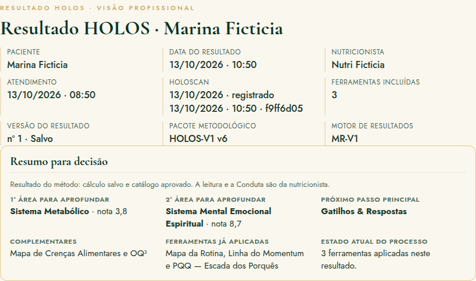
<figcaption><b>O que a nutricionista vê</b> O topo do Resultado HOLOS profissional: dados da aplicação, pacote metodológico (HOLOS-V1 v6) e o "Resumo para decisão" (paciente fictícia).</figcaption>
</figure>

<figure>
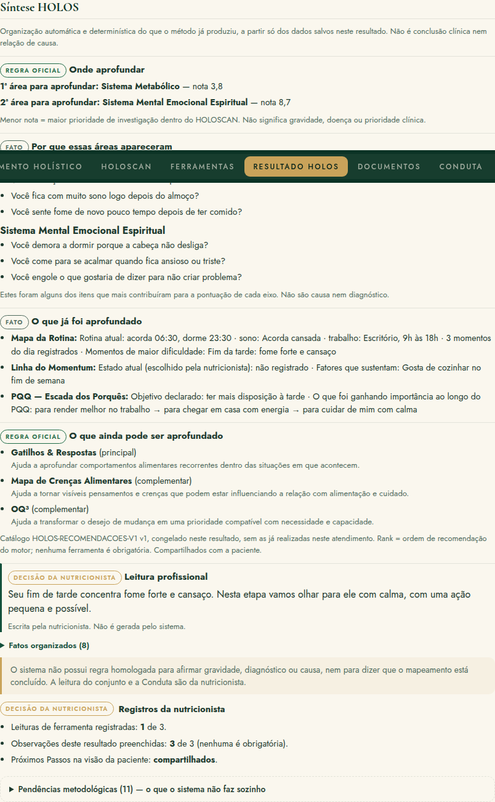
<figcaption><b>O que a nutricionista vê</b> A Síntese HOLOS: organização determinística do que o método produziu, separando regra oficial, fato e decisão da nutricionista.</figcaption>
</figure>

Quando um sistema aparece na 2ª posição sem ter tido nenhuma carga (nota 10,0), a visão profissional avisa que ele está ali **só pela ordem oficial de desempate**. Isso evita ler como prioridade algo que a paciente não relatou.

# O que a paciente recebe

Uma versão em linguagem humana: o que apareceu, o que isso significa, o que não significa, e o que foi combinado.

## As seções da visão da paciente ("Seu Mapa HOLOS")

| Seção | O que a paciente entende |
|---|---|
| O que entendemos nesta etapa | Onde o acompanhamento está focado e quais ferramentas foram feitas. |
| Áreas para aprofundar | As áreas que aparecem primeiro, com o que cada eixo reúne, o que mais contribuiu, o que significa e o que não significa. |
| O que descobrimos com as ferramentas | O que foi aprendido, só das ferramentas que a nutricionista escolheu mostrar. |
| Nosso foco agora | A leitura que a nutricionista escreveu para ela. |
| O que ficou combinado | Objetivo, estratégia, ações e acordos da Conduta. |
| O que observar até o próximo encontro | Os pontos para acompanhar. |
| Detalhes do mapa | Os cinco sistemas, o Índice e a Tríade, para quem quiser ver. |

<figure>
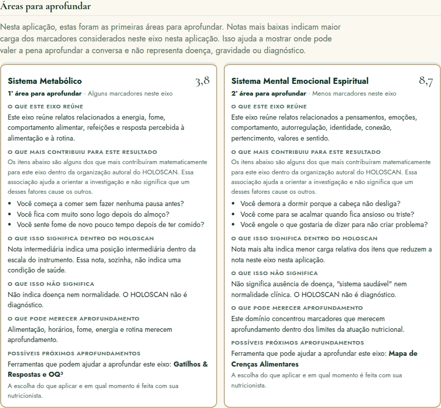
<figcaption><b>O que a paciente recebe</b> "Áreas para aprofundar" na visão da paciente (paciente fictícia). O contexto sem pontuação não aparece aqui, para não parecer o motivo da nota.</figcaption>
</figure>

<figure>
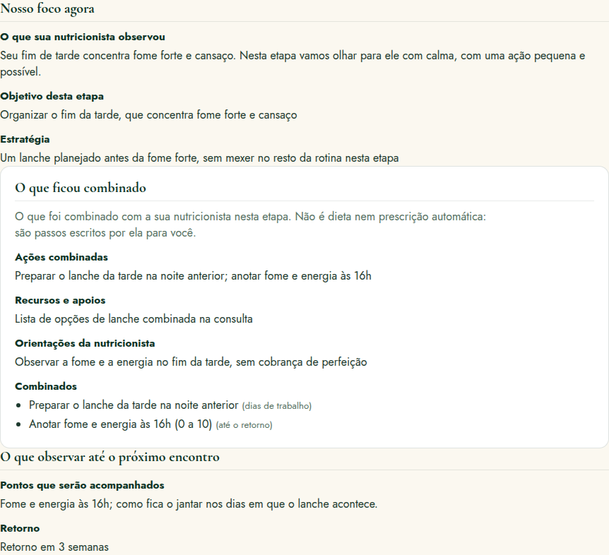
<figcaption><b>O que a paciente recebe</b> O foco, o que ficou combinado e o que observar até o próximo encontro.</figcaption>
</figure>

- Ela lê **o que apareceu** e **o que isso não significa** na mesma página.
- Não vê cobertura técnica, pendências metodológicas nem as questões internas da nutricionista.
- Não recebe diagnóstico, nem frases de causa e efeito entre emoção e corpo.

# Resultado Final, PDF e WhatsApp

Do resultado preparado na ficha à entrega para a paciente.

## Resultado HOLOS e Resultado Final: qual é a diferença

| | Resultado HOLOS | Resultado Final |
|---|---|---|
| Onde | Aba "Resultado HOLOS" da ficha | Menu "Resultado" |
| O que é | A síntese clínica da etapa, com visão profissional e visão da paciente | A **emissão** para a paciente: congela o Resultado HOLOS (visão da paciente), a Conduta do mesmo atendimento e a identidade profissional do Perfil |
| Pode mudar? | Sim, por nova versão | Não: cada emissão é imutável; uma mudança vira nova emissão |
| PDF | "Imprimir ou salvar em PDF" (impressão do navegador) | "Baixar PDF" e "Imprimir" |

## O fluxo de entrega

Resultado HOLOS salvo<i>→</i>Prévia<i>→</i>Gerar Resultado Final<i>→</i>PDF<i>→</i>WhatsApp

1. Na página "Resultado", a nutricionista vê a **PRÉVIA** do que a paciente vai receber.
2. **"Gerar Resultado Final"** congela o conteúdo: "Resultado Final nº X · conteúdo congelado".
3. **"Baixar PDF"** gera o arquivo no próprio navegador, com o nome, o registro profissional, o logo, a assinatura e o carimbo do Perfil.
4. **"Enviar pelo WhatsApp"**: no celular, abre o compartilhamento com o PDF anexado; no computador, baixa o PDF e abre a conversa com a mensagem pronta, e a nutricionista anexa o arquivo.

<figure>
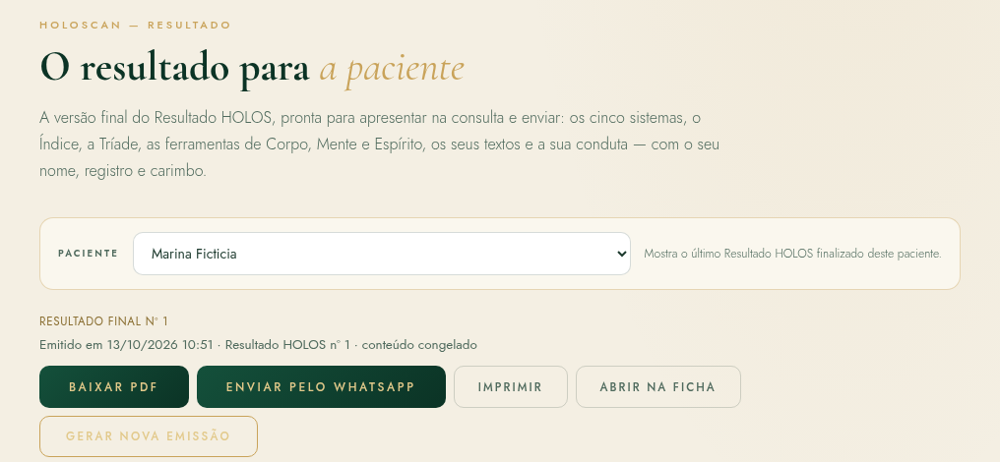
<figcaption><b>O que a nutricionista vê</b> Um Resultado Final emitido: conteúdo congelado, com Baixar PDF, Enviar pelo WhatsApp, Imprimir, Abrir na ficha e Gerar nova emissão (paciente fictícia).</figcaption>
</figure>

<figure>
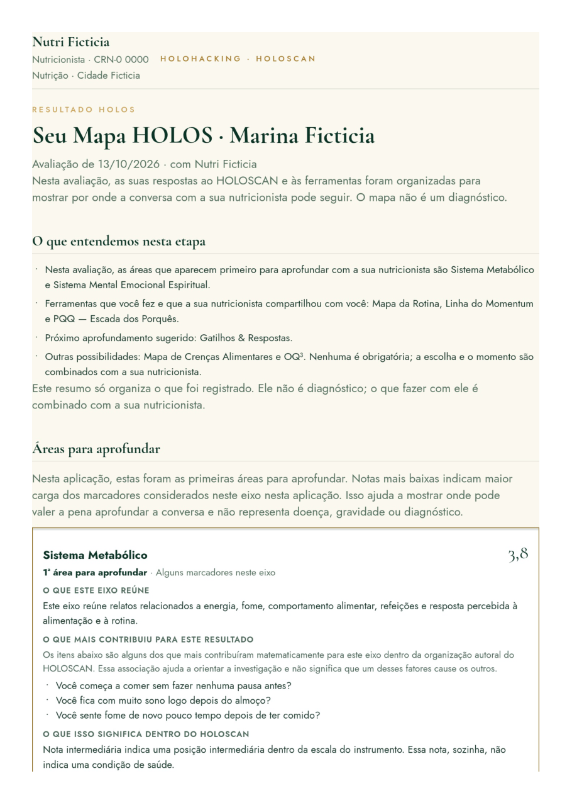
<figcaption><b>O que a paciente recebe</b> Primeira página do PDF.</figcaption>
</figure>
<figure>
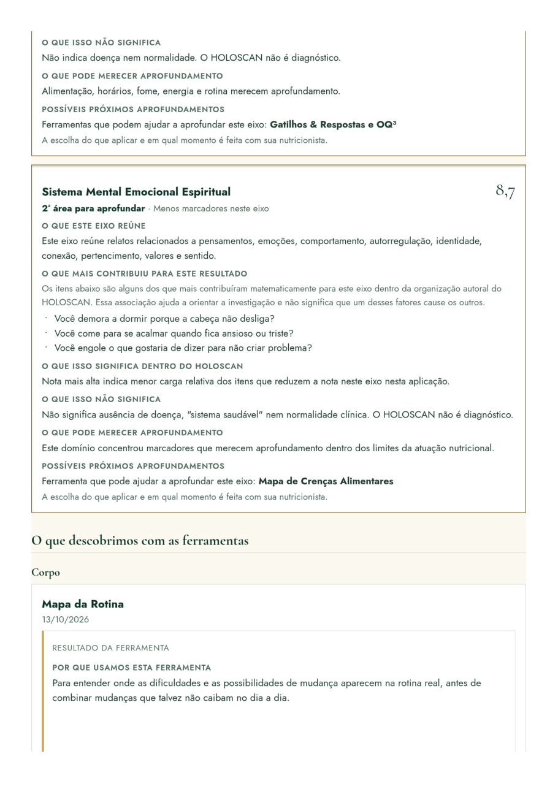
<figcaption><b>O que a paciente recebe</b> Segunda página do PDF.</figcaption>
</figure>

- **Nenhum link é enviado.** O PDF é gerado no navegador, sem página pública.
- Emissões anteriores ficam em "Emissões deste paciente".
- A mensagem do WhatsApp diz: *"Olá, [nome]! Segue o seu Resultado HOLOS ([data]). Ele organiza o que registramos na sua avaliação e os próximos passos que combinamos. Qualquer dúvida, é só me chamar."*

## Outros registros que acompanham a jornada

| Registro | O que faz | O que não faz |
|---|---|---|
| **Relatórios clínicos** | Relatório profissional com fontes escolhidas uma a uma; prévia, rascunho e emissão imutável (retificação gera nova emissão). | Não interpreta exames. |
| **Documentos** | Guarda exames, laudos, receitas e outros arquivos (até 10 MB), com tipo, título e data. | Não lê nem interpreta os arquivos; eles não entram no HOLOSCAN nem no Resultado. |
| **Linha do tempo** | Mostra os registros consolidados, com filtros por tipo. | Não cria registro novo. |
| **HOLOS AI** | Monta um texto de contexto do caso para a nutricionista copiar. | Não envia nada sozinho; a abertura direta em assistentes externos está "Em desenvolvimento". |

# Retornos: o princípio fundamental

Uma jornada de até 10 atendimentos não é um protocolo. É um exemplo de caminho possível, que cada nutricionista adapta a cada paciente.

Este é um exemplo de jornada possível. A escolha depende do caso. A nutricionista interpreta e decide.
<small>Princípio dos retornos</small>

## O que este capítulo não diz

- Não diz que a consulta 1 usa obrigatoriamente a ferramenta X e a consulta 2 a ferramenta Y.
- Não define intervalo entre consultas nem entre aplicações do HOLOSCAN.
- Não obriga alternar Corpo, Mente e Espírito.
- Não promete resultado clínico em nenhum número de consultas.

## O que o HoloHacking já oferece para os retornos

| Recurso | Como ajuda no retorno |
|---|---|
| **Agenda** | Tipos "Retorno" e "Reavaliação HOLOSCAN"; reagendar mantém o original no histórico. |
| **Mapeamento de retorno** | Enviado automaticamente no formato curto "Desde a última consulta" quando a paciente já tem Mapeamento concluído. |
| **Mapeamento profissional de retorno** | Tipo "Retorno", com o bloco "Desde a última consulta". |
| **Conduta anterior** | Aparece ao lado, com "Levar acordos para esta conduta" e a decisão de continuar, substituir ou encerrar cada acordo. |
| **Nova aplicação** | HOLOSCAN e ferramentas podem ser reaplicados; o histórico de cada um fica preservado. |
| **Resultado HOLOS** | Uma nova aplicação gera uma nova versão do Resultado; as anteriores ficam guardadas. |
| **Evolução** | Compara lado a lado: atendimento anterior × atual, linha de base × atual, dois atendimentos ou duas datas. |
| **Dashboard** | Mostra em que etapa cada paciente está (Aguardando Mapeamento, Mapeamento recebido, HOLOSCAN em andamento, Resultado pronto, Resultado apresentado, Aguardando retorno). |

**Evolução mostra lado a lado, sem calcular diferenças de nota, Índice, Tríade ou faixa.** A regra de comparabilidade entre aplicações ainda não foi homologada. Aplicações feitas em versões diferentes do pacote metodológico **não são comparadas como se fossem equivalentes**.

O HoloHacking ainda **não organiza a jornada em ciclos** (contagem de atendimentos, marcos de ciclo, síntese de fechamento). Hoje, o ciclo existe na condução da nutricionista e no histórico registrado; não há uma função de "ciclo".

# Mapa de um ciclo de até 10 atendimentos

Uma estrutura narrativa para pensar o acompanhamento ao longo do tempo. Não é regra clínica.

<b>Compreender e priorizar</b>Criar um ponto de partida organizado.

<b>Aprofundar</b>Entender melhor o padrão que apareceu primeiro.

<b>Testar e observar</b>Ver o que aconteceu quando os acordos encontraram a vida real.

<b>Integrar</b>Conectar alimentação, rotina, comportamento, emoção e contexto.

<b>Revisar o primeiro ciclo</b>Um checkpoint: de onde partimos, o que mudou, o que permanece.

<b>Aprofundar uma nova camada</b>Ir além do primeiro foco, sem repetir a primeira consulta.

<b>Consolidar</b>Consistência, sustentabilidade e pequenos ajustes.

<b>Autonomia</b>A paciente começa a reconhecer os próprios padrões.

<b>Reavaliação global</b>Início versus momento atual, com respeito ao versionamento.

<b>Fechamento do ciclo e próxima fase</b>Síntese, conquistas, o que continuar e como seguir.

Um ciclo pode ter menos encontros, pode pular etapas ou voltar a uma delas. Uma paciente pode precisar de três consultas de "aprofundar" antes de "testar"; outra pode chegar à autonomia cedo. A numeração ajuda a pensar, não a cobrar.

# Os 10 atendimentos, um a um

Para cada encontro: o que revisar antes, o que fazer durante, o que registrar depois, o objetivo e o resultado esperado do processo.

## Atendimento 1 — Compreender e priorizar

**Antes**
- Mapeamento recebido e lido.
- Revisão do contexto: queixa, objetivo, rotina, sinais relatados.

**Durante**
- Conversa.
- HOLOSCAN, quando pertinente.
- Leitura das áreas para aprofundar.
- Escolha do primeiro aprofundamento e, se couber, aplicação de uma ferramenta.

**Depois**
- Leitura profissional, Conduta e acordos.
- Resultado para a paciente.

**Objetivo do encontro:** criar um ponto de partida organizado.

**Resultado esperado do processo:** a paciente entende qual é o foco inicial e o que observar até o retorno.

Atendimento aberto · Mapeamento levado para o atendimento · HOLOSCAN salvo · ferramenta concluída (se houver) · Conduta · Resultado HOLOS · Resultado Final em PDF.

## Atendimento 2 — Aprofundar

Revisar os acordos, a percepção da paciente, as barreiras, as mudanças observadas e a ferramenta anterior.

O primeiro aprofundamento respondeu à pergunta que motivou a escolha?

Possibilidades:

- continuar no mesmo eixo, com outra ferramenta do mesmo sistema;
- aplicar uma ferramenta complementar sugerida no primeiro resultado;
- mudar para a segunda área para aprofundar;
- aprofundar Corpo, Mente ou Espírito conforme a conversa pedir.

Mapeamento de retorno · Conduta anterior ao lado da nova · "Próximos Passos HOLOS" do primeiro resultado (sem as ferramentas já feitas) · nova ferramenta.

Mais clareza sobre o padrão investigado.

## Atendimento 3 — Testar e observar

O foco é o que aconteceu quando os acordos encontraram a vida real: o que foi tentado, o que aconteceu, adesão, barreiras, contexto e aprendizado.

- Comparar o resultado de uma ferramenta com o da aplicação anterior, lado a lado.
- Reaplicar uma ferramenta, **quando isso fizer sentido** (não há regra automática de reaplicação).
- Usar outra ferramenta.
- Atualizar a Conduta: continuar, substituir ou encerrar cada acordo.

A paciente vê que "não deu certo" também é informação, e a Conduta passa a refletir o que é possível de verdade.

## Atendimento 4 — Integrar

Começar a conectar alimentação, rotina, comportamento, emoções, contexto, prioridades e as respostas aos acordos. A aba Evolução ajuda a ver o caminho até aqui, lado a lado.

O que estamos entendendo agora que não estava claro no início?

Uma leitura mais integrada da paciente, registrada pela nutricionista, que conecta o que antes parecia solto.

## Atendimento 5 — Revisão do primeiro ciclo

Um checkpoint. Rever o ponto de partida, as áreas iniciais, as ferramentas usadas, os acordos, as mudanças percebidas, as dificuldades que persistem, o aprendizado da paciente e a necessidade de novo aprofundamento.

**Quando considerar uma nova aplicação do HOLOSCAN?** Por exemplo, quando a conversa sugere que o retrato inicial mudou, quando a paciente relata mudanças importantes de rotina ou de momento de vida, ou quando a nutricionista quer revisar as áreas para aprofundar com dados novos.

**A reaplicação é decisão profissional e contextual, até que uma regra oficial de periodicidade seja definida.** O HoloHacking não sugere nem exige intervalo. A Agenda tem o tipo "Reavaliação HOLOSCAN" para quando a nutricionista decidir.

## Atendimento 6 — Aprofundar uma nova camada

Depois do primeiro ciclo: aprofundar algo que permaneceu, investigar a segunda prioridade, trabalhar uma barreira nova ou usar outra ferramenta quando pertinente.

O acompanhamento não precisa repetir a primeira consulta. O que já está registrado (Mapeamento, HOLOSCAN, ferramentas, Condutas) continua disponível; o novo encontro parte dali.

## Atendimento 7 — Consolidar

Foco em consistência, sustentabilidade, obstáculos recorrentes, autonomia e pequenos ajustes. Ferramentas podem ser revisitadas quando agregarem informação.

Acordos que já se sustentam saem do foco; os que ainda pesam são simplificados.

## Atendimento 8 — Autonomia

**No início**

A nutricionista ajuda a organizar e a enxergar.

**Mais adiante**

A paciente começa a reconhecer os próprios padrões.

Possíveis resultados do processo: maior percepção, capacidade de antecipar gatilhos, mais consciência das escolhas, rotina mais coerente, decisões mais autônomas.

Esses são resultados possíveis **do processo**, não promessas de resultado clínico.

## Atendimento 9 — Reavaliação global

Rever a jornada completa: **início versus momento atual**.

- Nova aplicação do HOLOSCAN, se profissionalmente indicada.
- Comparação descritiva, lado a lado, na aba Evolução.
- Ferramentas anteriores, Condutas e acordos.
- Percepção da paciente e mudanças observáveis.

**Respeitar o versionamento.** Se a primeira aplicação foi feita numa versão anterior do pacote metodológico, os números não são comparados como se fossem equivalentes. A Evolução mostra lado a lado, sem diferença calculada.

## Atendimento 10 — Fechamento do ciclo e próxima fase

Uma consulta de síntese. Perguntas que orientam:

- De onde partimos?
- O que aprendemos?
- Quais padrões ficaram claros?
- O que mudou?
- O que permanece?
- Quais estratégias foram sustentáveis?

- O que a paciente já conduz com mais autonomia?
- Existe nova prioridade?
- Precisamos de um novo ciclo?
- O intervalo entre consultas pode aumentar?
- O acompanhamento entra em manutenção?
- Existe necessidade de outro profissional?

O que o fechamento produz:

| Bloco | Conteúdo |
|---|---|
| **Síntese do ciclo** | De onde partimos, o caminho percorrido, o que foi aprendido. |
| **Foco atual** | O que continua importante agora. |
| **Conquistas e mudanças observadas** | Nas palavras da paciente e no registro da nutricionista. |
| **Pontos a continuar observando** | O que ainda pede atenção. |
| **Plano para a próxima fase** | Novo ciclo, manutenção, intervalo maior ou encaminhamento. |

Hoje, o fechamento pode ser registrado com os recursos existentes: a **Conduta** do atendimento (objetivo, orientações, retorno), as **observações do Resultado HOLOS** e um **Relatório clínico** emitido com as fontes escolhidas.

Um documento próprio de **Síntese do Ciclo**, gerado a partir do histórico e editado pela nutricionista, ainda não existe no produto.

# Resultados esperados de um ciclo

O que um ciclo de acompanhamento pode produzir, descrito como resultado do processo, não como promessa.

Este capítulo **não promete** cura, perda de peso, reversão de doença, melhora hormonal, melhora metabólica nem qualquer resultado clínico garantido.

**Resultados de compreensão**
- Maior compreensão da própria rotina.
- Identificação de padrões alimentares.
- Reconhecimento de gatilhos.
- Mais clareza sobre fome e saciedade, quando pertinente.
- Melhor compreensão das próprias barreiras.

**Resultados de comportamento**
- Maior consciência das escolhas.
- Estratégias mais realistas, que cabem na rotina.
- Capacidade de perceber recaídas sem transformar tudo em fracasso.

**Resultados de autonomia**
- Mais autonomia nas decisões do dia a dia.
- Maior participação na construção da própria Conduta.
- Capacidade de antecipar situações difíceis.

**Resultados do acompanhamento**
- Histórico organizado do processo.
- Clareza sobre o que funcionou e o que não funcionou.
- Próximos passos definidos.

**Resultados clínicos.** Resultados clínicos dependem do quadro individual, avaliação profissional, adesão, contexto e outros fatores e não são garantidos pelo método ou pela plataforma.

# Caso fictício: Marina

Uma paciente inventada, acompanhada pela mesma nutricionista ao longo de dez encontros. A história tem avanços, recaídas e ajustes, como costuma acontecer.

**Marina é fictícia.** Nome, idade, rotina, relatos e números foram criados para este documento. Nada aqui é diagnóstico, e nenhuma escolha de ferramenta é regra: são decisões possíveis de uma nutricionista diante deste caso.

## Quem é Marina

Marina tem 37 anos, trabalha num escritório das 9h às 18h e mora com o companheiro e um filho de 6 anos. Procurou acompanhamento porque quer **"ter mais energia à tarde e parar de beliscar à noite"**. Já fez dietas antes e "sempre largou no meio". Acorda cansada, almoça rápido, sente fome forte no fim da tarde e, à noite, come "o que tiver" enquanto organiza a casa.

1
<b>Compreender e priorizar</b>Primeira consulta

<dl>
<dt>Entrada</dt><dd>Mapeamento enviado pelo WhatsApp três dias antes e respondido em uma noite. Na consulta, a nutricionista abre o atendimento e leva o Mapeamento para o atendimento.</dd>
<dt>O que ela relata</dt><dd>Sono que não descansa, almoço corrido, fome forte às 16h30, beliscar à noite "para relaxar", culpa depois.</dd>
<dt>O que a nutricionista organiza</dt><dd>Aplica o HOLOSCAN. A 1ª área para aprofundar é o Sistema Metabólico (nota 3,8); a 2ª, o Sistema Mental Emocional Espiritual (8,7). Os sinais que mais pontuaram no Metabólico: começar a comer sem pausa, sono depois do almoço, fome pouco depois de comer.</dd>
<dt>Parte do sistema</dt><dd>Mapeamento Holístico, HOLOSCAN, Próximos Passos HOLOS, Mapa da Rotina, Conduta, Resultado HOLOS, Resultado Final.</dd>
<dt>Ferramenta</dt><dd><strong>Mapa da Rotina</strong> (principal sugerida pelo catálogo para o Metabólico).</dd>
<dt>Por que esta</dt><dd>A conversa confirmou que o problema "acontece no relógio": a ferramenta ajuda a localizar onde a fome e o cansaço aparecem no dia real, antes de combinar qualquer mudança.</dd>
<dt>O que foi aprendido</dt><dd>O fim da tarde concentra fome forte e cansaço; o almoço é o momento mais estável; a manhã é corrida.</dd>
<dt>Conduta / acordo</dt><dd>Objetivo: organizar o fim da tarde. Acordos: preparar o lanche da tarde na noite anterior; anotar fome e energia às 16h (0 a 10).</dd>
<dt>Até o próximo encontro</dt><dd>Como fica o jantar nos dias em que o lanche acontece.</dd>
<dt>Histórico</dt><dd>Primeiro atendimento, primeiro HOLOSCAN (HOLOS-V1 v6), primeira Conduta e Resultado Final nº 1 enviado em PDF.</dd>
</dl>

2
<b>Aprofundar</b>Retorno · 3 semanas depois

<dl>
<dt>Entrada</dt><dd>Mapeamento de retorno ("Desde a última consulta") respondido na véspera.</dd>
<dt>O que ela relata</dt><dd>Conseguiu o lanche em dois de cinco dias. Nos dias com lanche, chegou menos faminta. À noite, continua beliscando quando chega cansada.</dd>
<dt>O que a nutricionista organiza</dt><dd>O primeiro aprofundamento respondeu à pergunta da tarde; a noite ainda está em aberto. A complementar sugerida no primeiro resultado foi Gatilhos & Respostas.</dd>
<dt>Parte do sistema</dt><dd>Mapeamento de retorno, Conduta anterior ao lado, Gatilhos & Respostas.</dd>
<dt>Ferramenta</dt><dd><strong>Gatilhos &amp; Respostas</strong>, com um episódio da noite anterior.</dd>
<dt>Por que esta</dt><dd>O beliscar noturno é um comportamento recorrente; a ferramenta torna observável o que acontece antes e depois dele.</dd>
<dt>O que foi aprendido</dt><dd>Gatilho: chegar em casa e ver a louça; pensamento "não vou dar conta"; emoção: cansaço e irritação (7/10); resposta: comer de pé, beliscando; depois, culpa.</dd>
<dt>Conduta / acordo</dt><dd>Continuar o lanche da tarde. Novo acordo: ao chegar, sentar e comer algo planejado antes de começar as tarefas da casa.</dd>
<dt>Até o próximo encontro</dt><dd>Registrar mais dois episódios, se acontecerem.</dd>
<dt>Histórico</dt><dd>Segunda Conduta (com os acordos anteriores revistos), primeira aplicação de Gatilhos & Respostas.</dd>
</dl>

3
<b>Testar e observar</b>Retorno

<dl>
<dt>Entrada</dt><dd>Mapeamento de retorno. Marina avisa que a semana foi difícil.</dd>
<dt>O que ela relata</dt><dd>O filho ficou doente; ela "desandou tudo". O lanche da tarde se manteve em três dias; a noite piorou.</dd>
<dt>O que a nutricionista organiza</dt><dd>A semana trouxe uma carga de vida maior. Antes de pedir mais, vale entender quanto espaço existe agora.</dd>
<dt>Parte do sistema</dt><dd>Linha do Momentum, Conduta.</dd>
<dt>Ferramenta</dt><dd><strong>Linha do Momentum</strong>. Estado escolhido pela nutricionista: <strong>Reorganizar</strong>.</dd>
<dt>Por que esta</dt><dd>Ajuda a calibrar a exigência quando os acordos não se sustentaram por falta de espaço, não de vontade.</dd>
<dt>O que foi aprendido</dt><dd>Energia disponível baixa, carga de vida alta, suporte médio. O que não é hora de pedir: mudanças no jantar da família.</dd>
<dt>Conduta / acordo</dt><dd>Manter só o lanche da tarde. O acordo da noite fica "em acompanhamento", sem cobrança.</dd>
<dt>Até o próximo encontro</dt><dd>Perceber o que torna os dias com lanche possíveis.</dd>
<dt>Histórico</dt><dd>Uma recaída registrada como informação, não como fracasso.</dd>
</dl>

4
<b>Integrar</b>Retorno

<dl>
<dt>Entrada</dt><dd>Marina chega mais tranquila. O lanche aconteceu em quatro de cinco dias.</dd>
<dt>O que ela relata</dt><dd>Nos dias com lanche, o jantar fica mais calmo. Diz que quer "dar conta" sem se sentir sempre atrasada.</dd>
<dt>O que a nutricionista organiza</dt><dd>Começa a conectar rotina, fome, cansaço e o desejo de "dar conta". A Evolução mostra as Condutas e as ferramentas lado a lado.</dd>
<dt>Parte do sistema</dt><dd>PQQ, Evolução.</dd>
<dt>Ferramenta</dt><dd><strong>PQQ — Escada dos Porquês</strong> (sugerida para a 2ª área, o Mental Emocional Espiritual).</dd>
<dt>Por que esta</dt><dd>Para entender o que "ter mais energia" representa para ela e manter as mudanças ligadas a esse sentido.</dd>
<dt>O que foi aprendido</dt><dd>O "pra que" verdadeiro: "sentir que dou conta da minha rotina sem me abandonar".</dd>
<dt>Conduta / acordo</dt><dd>Lanche mantido; pausa de cinco minutos antes do almoço, sem tela.</dd>
<dt>Até o próximo encontro</dt><dd>Como a pausa antes do almoço muda a tarde.</dd>
<dt>Histórico</dt><dd>Com OQ³ ainda não aplicado, o Mapa do Propósito fica para depois, se fizer sentido.</dd>
</dl>

5
<b>Revisar o primeiro ciclo</b>Retorno · checkpoint

<dl>
<dt>Entrada</dt><dd>Consulta marcada como "Reavaliação HOLOSCAN" na Agenda, por decisão da nutricionista.</dd>
<dt>O que ela relata</dt><dd>A tarde mudou; a noite melhorou em parte. A culpa depois de comer ainda aparece.</dd>
<dt>O que a nutricionista organiza</dt><dd>Revê o ponto de partida, as áreas iniciais, as ferramentas e os acordos. Decide reaplicar o HOLOSCAN porque a rotina mudou desde a primeira aplicação.</dd>
<dt>Parte do sistema</dt><dd>HOLOSCAN (segunda aplicação, mesma versão do pacote), Evolução lado a lado, nova versão do Resultado HOLOS.</dd>
<dt>Ferramenta</dt><dd>Nenhuma nova: o encontro é de revisão.</dd>
<dt>Por que</dt><dd>A prioridade era olhar o caminho, não abrir outra frente.</dd>
<dt>O que foi aprendido</dt><dd>O Metabólico continua como 1ª área, com menos carga relatada nos sinais da tarde. A culpa depois de comer segue entre os sinais do Mental Emocional Espiritual.</dd>
<dt>Conduta / acordo</dt><dd>Lanche e pausa viram rotina; nova pergunta para o próximo ciclo: o que acontece quando ela "sai da linha".</dd>
<dt>Até o próximo encontro</dt><dd>Observar os dias em que ela sente que "perdeu tudo".</dd>
<dt>Histórico</dt><dd>Duas aplicações do HOLOSCAN na mesma versão, vistas lado a lado, sem cálculo de diferença.</dd>
</dl>

6
<b>Aprofundar uma nova camada</b>Retorno

<dl>
<dt>Entrada</dt><dd>Um fim de semana de festa: "Comi demais no sábado, então o domingo já estava perdido".</dd>
<dt>O que ela relata</dt><dd>Quando "sai da linha", abandona tudo até segunda-feira.</dd>
<dt>O que a nutricionista organiza</dt><dd>Há uma regra rígida operando. É hora de olhar para as ideias, não só para a rotina.</dd>
<dt>Parte do sistema</dt><dd>Mapa de Crenças Alimentares.</dd>
<dt>Ferramenta</dt><dd><strong>Mapa de Crenças Alimentares</strong>.</dd>
<dt>Por que esta</dt><dd>Ajuda a tornar visíveis as ideias que influenciam as escolhas e a observá-las em situações reais.</dd>
<dt>O que foi aprendido</dt><dd>Crença que mais atrapalha: "se eu errar uma refeição, o dia está perdido". De onde veio: dietas anteriores. Alternativa possível: "a próxima refeição é uma nova chance".</dd>
<dt>Conduta / acordo</dt><dd>Depois de um exagero, voltar ao combinado na refeição seguinte, sem compensar.</dd>
<dt>Até o próximo encontro</dt><dd>Perceber quando a frase antiga aparece.</dd>
<dt>Histórico</dt><dd>A camada nova aparece sem repetir a primeira consulta: o que já estava registrado continua valendo.</dd>
</dl>

7
<b>Consolidar</b>Retorno · intervalo maior

<dl>
<dt>Entrada</dt><dd>Quatro semanas depois, por decisão combinada.</dd>
<dt>O que ela relata</dt><dd>Conseguiu "voltar no dia seguinte" duas vezes. O trabalho anda pesado.</dd>
<dt>O que a nutricionista organiza</dt><dd>Os acordos centrais se sustentam. O trabalho parece puxar outras áreas para baixo.</dd>
<dt>Parte do sistema</dt><dd>Roda Holística da Vida, Conduta.</dd>
<dt>Ferramenta</dt><dd><strong>Roda Holística da Vida</strong>.</dd>
<dt>Por que esta</dt><dd>Amplia o olhar quando diferentes áreas da vida ocupam energia e espaço.</dd>
<dt>O que foi aprendido</dt><dd>Área mais cuidada: relações. Menos cuidadas: lazer e saúde. A que puxa as outras para baixo: trabalho.</dd>
<dt>Conduta / acordo</dt><dd>Simplificar: um acordo só para a semana de fechamento do mês no trabalho.</dd>
<dt>Até o próximo encontro</dt><dd>O que mantém o lanche possível nas semanas pesadas.</dd>
<dt>Histórico</dt><dd>Acordos já sustentados saem do foco; ficam registrados como "Concluído".</dd>
</dl>

8
<b>Autonomia</b>Retorno

<dl>
<dt>Entrada</dt><dd>Marina chega com uma estratégia própria.</dd>
<dt>O que ela relata</dt><dd>"Na semana do fechamento, preparei os lanches no domingo. Pedi ajuda ao meu companheiro com o jantar."</dd>
<dt>O que a nutricionista organiza</dt><dd>Ela começa a antecipar as próprias situações difíceis. O apoio em casa apareceu como recurso.</dd>
<dt>Parte do sistema</dt><dd>Conexão &amp; Pertencimento.</dd>
<dt>Ferramenta</dt><dd><strong>Conexão &amp; Pertencimento</strong>.</dd>
<dt>Por que esta</dt><dd>Para planejar acordos que contem com o apoio real que ela tem.</dd>
<dt>O que foi aprendido</dt><dd>O companheiro apoia; a irmã apoia de longe; o ambiente de trabalho dificulta nos dias de pressão.</dd>
<dt>Conduta / acordo</dt><dd>Marina propõe o próprio acordo: dividir o jantar de quarta e sexta.</dd>
<dt>Até o próximo encontro</dt><dd>Como é ter ajuda sem sentir que "falhou".</dd>
<dt>Histórico</dt><dd>Pela primeira vez, um acordo nasce da paciente.</dd>
</dl>

9
<b>Reavaliação global</b>Retorno · Reavaliação HOLOSCAN

<dl>
<dt>Entrada</dt><dd>Consulta marcada como "Reavaliação HOLOSCAN".</dd>
<dt>O que ela relata</dt><dd>"Ainda belisco às vezes, mas não vira o dia inteiro."</dd>
<dt>O que a nutricionista organiza</dt><dd>Compara o início com o momento atual: Mapeamentos, aplicações do HOLOSCAN, ferramentas, Condutas e acordos. Se uma aplicação tivesse sido feita em outra versão do pacote, os números não seriam comparados como equivalentes.</dd>
<dt>Parte do sistema</dt><dd>HOLOSCAN (terceira aplicação), Evolução ("Linha de base × atual"), nova versão do Resultado HOLOS.</dd>
<dt>Ferramenta</dt><dd>Nenhuma nova.</dd>
<dt>Por que</dt><dd>O encontro é de leitura do caminho.</dd>
<dt>O que foi aprendido</dt><dd>Menos carga relatada nos sinais da tarde e da refeição; a culpa depois de comer aparece com menos frequência no relato dela. Nada disso é tratado como diagnóstico.</dd>
<dt>Conduta / acordo</dt><dd>Preparar o fechamento do ciclo no próximo encontro.</dd>
<dt>Até o próximo encontro</dt><dd>Marina pensa no que quer levar para a próxima fase.</dd>
<dt>Histórico</dt><dd>Três aplicações, lado a lado, na mesma versão do pacote.</dd>
</dl>

10
<b>Fechamento do ciclo e próxima fase</b>Consulta de síntese

<dl>
<dt>Entrada</dt><dd>A nutricionista prepara a síntese a partir do histórico.</dd>
<dt>O que ela relata</dt><dd>"Eu entendi que meu problema não era falta de força de vontade, era o fim da tarde."</dd>
<dt>O que a nutricionista organiza</dt><dd>De onde partiram, o que mudou, o que permanece, o que Marina já conduz sozinha.</dd>
<dt>Parte do sistema</dt><dd>Conduta, Resultado HOLOS (observações), Relatório clínico, Carta ao Futuro Eu (opcional).</dd>
<dt>Ferramenta</dt><dd><strong>Carta ao Futuro Eu</strong>, escrita por Marina para daqui a seis meses.</dd>
<dt>Por que esta</dt><dd>Para dar à próxima fase uma referência de direção que seja dela.</dd>
<dt>O que foi aprendido</dt><dd>Síntese: foco no fim da tarde, estratégias que cabem na rotina, apoio em casa, menos "tudo ou nada".</dd>
<dt>Conduta / acordo</dt><dd>Manutenção, com retorno em dois meses. Pontos a continuar observando: semanas de fechamento no trabalho e a frase "perdi tudo".</dd>
<dt>Até o próximo encontro</dt><dd>Marina segue sozinha os acordos que já são dela.</dd>
<dt>Histórico</dt><dd>Um ciclo completo, registrado do Mapeamento à síntese.</dd>
</dl>

Ao final do ciclo, Marina não recebeu um "diagnóstico" nem uma lista de proibições. Recebeu, a cada etapa, o que foi entendido, o que foi combinado e o que observar. E aprendeu a ler os próprios padrões.

# Visão resumida dos 10 atendimentos

O ciclo inteiro em duas tabelas: o que se faz em cada encontro e o que cada encontro deixa.

## O que se faz

<table class="pequena">
<thead><tr><th>Atend.</th><th>Objetivo</th><th>Dados consultados</th><th>Recurso do HoloHacking</th><th>Possível ferramenta</th></tr></thead>
<tbody>
<tr><td><b>1</b></td><td>Compreender e priorizar</td><td>Mapeamento, conversa</td><td>Atendimento, HOLOSCAN, Próximos Passos, Conduta, Resultado HOLOS, Resultado Final</td><td>A principal sugerida pelo catálogo, se couber (ex.: Mapa da Rotina)</td></tr>
<tr><td><b>2</b></td><td>Aprofundar</td><td>Mapeamento de retorno, acordos, ferramenta anterior</td><td>Conduta anterior ao lado, Próximos Passos sem as já feitas</td><td>Complementar do catálogo (ex.: Gatilhos & Respostas)</td></tr>
<tr><td><b>3</b></td><td>Testar e observar</td><td>O que foi tentado, adesão, barreiras</td><td>Nova aplicação de ferramenta, revisão de acordos</td><td>Linha do Momentum, reaplicação quando fizer sentido</td></tr>
<tr><td><b>4</b></td><td>Integrar</td><td>Histórico até aqui</td><td>Evolução lado a lado</td><td>PQQ ou outra do território que a conversa pedir</td></tr>
<tr><td><b>5</b></td><td>Revisar o primeiro ciclo</td><td>Ponto de partida × agora</td><td>Reavaliação HOLOSCAN (se decidida), nova versão do Resultado</td><td>Nenhuma nova, em geral</td></tr>
<tr><td><b>6</b></td><td>Nova camada</td><td>O que permaneceu, 2ª prioridade</td><td>Próximos Passos, ferramentas</td><td>Mapa de Crenças Alimentares, Gatilhos & Respostas</td></tr>
<tr><td><b>7</b></td><td>Consolidar</td><td>Acordos sustentados e recorrências</td><td>Estados dos acordos, Conduta</td><td>Roda Holística da Vida, revisitar uma anterior</td></tr>
<tr><td><b>8</b></td><td>Autonomia</td><td>Estratégias da própria paciente</td><td>Conduta construída com a paciente</td><td>Conexão & Pertencimento</td></tr>
<tr><td><b>9</b></td><td>Reavaliação global</td><td>Início × momento atual</td><td>HOLOSCAN (se indicado), Evolução "Linha de base × atual"</td><td>Nenhuma nova, em geral</td></tr>
<tr><td><b>10</b></td><td>Fechamento e próxima fase</td><td>Todo o histórico</td><td>Conduta, observações do Resultado, Relatório clínico</td><td>Carta ao Futuro Eu, Mapa do Propósito (opcionais)</td></tr>
</tbody></table>

## O que cada encontro deixa

<table class="pequena">
<thead><tr><th>Atend.</th><th>Decisão profissional</th><th>Resultado produzido</th><th>O que a paciente leva</th><th>Próximo passo</th></tr></thead>
<tbody>
<tr><td><b>1</b></td><td>Primeiro foco e primeiro acordo</td><td>HOLOSCAN, Conduta, Resultado HOLOS</td><td>PDF com o foco e o combinado</td><td>Observar até o retorno</td></tr>
<tr><td><b>2</b></td><td>Manter o eixo, complementar ou mudar de área</td><td>Nova ferramenta, Conduta revista</td><td>Clareza sobre o padrão</td><td>Testar o acordo novo</td></tr>
<tr><td><b>3</b></td><td>Calibrar a exigência</td><td>Acordos ajustados ao possível</td><td>"Não deu certo" também é informação</td><td>Sustentar o essencial</td></tr>
<tr><td><b>4</b></td><td>Conectar os achados</td><td>Leitura integrada registrada</td><td>Entendimento do próprio caminho</td><td>Preparar a revisão</td></tr>
<tr><td><b>5</b></td><td>Reaplicar ou não o HOLOSCAN; novo foco</td><td>Checkpoint do ciclo</td><td>O que mudou, o que fica</td><td>Abrir nova camada</td></tr>
<tr><td><b>6</b></td><td>Qual camada aprofundar</td><td>Nova ferramenta, novos acordos</td><td>Um padrão novo nomeado</td><td>Observar em situações reais</td></tr>
<tr><td><b>7</b></td><td>O que sai do foco</td><td>Acordos concluídos ou simplificados</td><td>Rotina mais estável</td><td>Espaçar consultas, se fizer sentido</td></tr>
<tr><td><b>8</b></td><td>Dar espaço à autonomia</td><td>Acordo proposto pela paciente</td><td>Confiança nas próprias estratégias</td><td>Reavaliar o percurso</td></tr>
<tr><td><b>9</b></td><td>Como ler o início × agora</td><td>Comparação descritiva, lado a lado</td><td>Visão do caminho percorrido</td><td>Fechar o ciclo</td></tr>
<tr><td><b>10</b></td><td>Novo ciclo, manutenção, intervalo ou encaminhamento</td><td>Síntese do ciclo e plano</td><td>Síntese, conquistas e o que continuar</td><td>Próxima fase</td></tr>
</tbody></table>

# Corpo, Mente e Espírito ao longo da jornada

Três territórios, não três trilhos. A mesma paciente transita entre eles conforme o momento pede.

**Corpo**

Muitas vezes o ponto de partida: rotina, horários, fome, energia. É onde as mudanças precisam caber.

**Mente**

Aparece quando o "porquê" e os padrões pedem atenção: crenças, gatilhos, sentido da mudança.

**Espírito**

Ganha espaço quando direção, valores, apoio e pertencimento sustentam (ou dificultam) o caminho.

No caso de Marina, a jornada começou pelo **Corpo** (Mapa da Rotina), passou pela **Mente** (Gatilhos & Respostas, PQQ, Crenças), voltou ao **Corpo** quando a vida apertou (Linha do Momentum), abriu o **Espírito** (Roda, Conexão, Carta) e voltou à rotina na manutenção.

**Não existe alternância obrigatória** Corpo → Mente → Espírito. O acompanhamento é adaptativo: segue o que a paciente mostra, não um roteiro.

# Acompanhamento longitudinal

A força do HoloHacking aparece com o tempo: cada encontro acrescenta uma camada ao histórico.

A cada encontro, o HoloHacking acumula: o atendimento; os relatos (Mapeamentos); as aplicações do HOLOSCAN; as ferramentas; a leitura profissional; a Conduta e os acordos, com os seus estados; os Resultados HOLOS e as emissões; os documentos; e a linha do tempo.

Dado isolado<i>→</i>Histórico<i>→</i>Padrão<i>→</i>Aprendizado<i>→</i>Decisão profissional<i>→</i>Novo ciclo

O sistema guarda e mostra o histórico; **não infere causalidade**. Quem reconhece padrões e decide o que fazer com eles é a nutricionista, com a paciente.

- Nada salvo é recalculado em silêncio: aplicações, Resultados e emissões ficam como foram feitos, com a versão do pacote metodológico usada.
- Quando o método evolui (uma nova versão do pacote), as aplicações antigas continuam legíveis e não são misturadas com as novas como se fossem iguais.
- A Evolução compara lado a lado, sem calcular diferenças de nota.

# Papéis

Quem faz o quê na jornada. Esses papéis não se invertem.

<b>Paciente</b>relata, participa, experimenta, observa

<b>Nutricionista</b>escuta, investiga, interpreta, decide, conduz

<b>HOLOSCAN</b>organiza os relatos segundo o método

<b>Ferramentas</b>aprofundam áreas específicas

<b>HoloHacking</b>registra e organiza a jornada

<b>Tecnologia</b>apoia

O algoritmo não decide tratamento. A tecnologia apoia; a nutricionista conduz.

# Limites e segurança

O que o HoloHacking não faz, e o que a nutricionista faz quando algo ultrapassa a nutrição.

**O HoloHacking:**
- não diagnostica;
- não substitui avaliação clínica;
- não substitui o julgamento profissional;
- não faz psicoterapia;
- não transforma associação em causalidade;
- não usa linguagem espiritual como se fosse fisiologia comprovada;
- não decide a Conduta sozinho;
- não interpreta exames nem documentos anexados.

Quando surge uma necessidade **fora da competência nutricional** (sofrimento emocional importante, sinais que pedem investigação médica, suspeita de transtorno alimentar), a nutricionista **encaminha** ao profissional adequado. O HoloHacking registra; não encaminha sozinho.

## Linguagem segura

| Em vez de | Prefira |
|---|---|
| "Seu sistema metabólico está ruim." | "Este eixo reuniu mais relatos nesta aplicação." |
| "Você tem fungos / está inflamada / tem toxinas." | "Esses relatos merecem ser aprofundados na conversa." |
| "Seu corpo está dizendo que…" | "O que você relatou mostra que vale olharmos para…" |
| "Esse é o verdadeiro motivo." | "Esse padrão apareceu no seu relato." |
| "Gravidade", "risco" | "Prioridade de investigação nesta etapa." |

# Visão futura

Pontos em que este documento descreve uma experiência desejada que ainda não existe no produto. Estão separados para não serem confundidos com funções atuais.

| Experiência desejada | Como é hoje |
|---|---|
| **Ciclo de atendimentos no sistema** (contagem, marcos, "ciclo atual") | Não existe. O ciclo é conduzido pela nutricionista e fica no histórico. |
| **Síntese do Ciclo** como documento próprio | Não existe. Usa-se a Conduta, as observações do Resultado HOLOS e um Relatório clínico. |
| **Regra oficial de periodicidade do HOLOSCAN** | Não existe. Reaplicar é decisão profissional (Agenda tem o tipo "Reavaliação HOLOSCAN"). |
| **Comparação metodológica entre aplicações** (diferenças de nota, Índice e Tríade) | Não existe. A Evolução mostra lado a lado, sem delta; a regra de comparabilidade não foi homologada. |
| **Acompanhamento entre consultas pela paciente** (registrar acordos, lembretes) | Não existe. A paciente recebe o PDF; o registro entre consultas acontece no Mapeamento de retorno. |
| **Envio do Resultado por link** | Não existe. O Resultado vai em PDF (WhatsApp no celular com anexo; no computador, a nutricionista anexa). |
| **HOLOS AI integrada** | Parcial. Hoje monta e copia o contexto do caso; a abertura direta em assistentes externos está "Em desenvolvimento". |
| **Estados de consulta** (confirmada, realizada, faltou) | Não existe. A Agenda tem consultas ativas, canceladas ou com atendimento registrado. |
| **Sugestão automática de data de retorno** | Foi retirada. O retorno é combinado e registrado na Conduta e na Agenda. |
| **Texto aprovado "por que usamos" e "o que significa" para todas as ferramentas** | Parcial. Hoje existe para algumas (Mapa da Rotina e PQQ, em "por que usamos"). |

# Encerramento

O sistema organiza. O método orienta. A tecnologia sugere. A nutricionista interpreta. A nutricionista decide.
<small>HoloHacking · Nutrição Holística</small>

Este é o primeiro modelo do guia **Jornada da Nutricionista com a Paciente**. Ele foi escrito para ser completo; as próximas versões vão condensar, ajustar o tom e incorporar o que a prática mostrar.

Espaço reservado para a assinatura do método, créditos e contato institucional (a definir).

Documento baseado no HoloHacking em outubro de 2026, pacote metodológico HOLOS-V1 v6 e catálogo de Próximos Passos PP-V1. Todas as pessoas, telas e dados de exemplo são fictícios.

