# IMPLEMENTAÇÃO — NOVO MOTOR DE RESULTADOS HOLOHACKING V1 (MR-V1)

Branch `claude/admiring-mccarthy-jke2pf`, de 12/10 a 13/10. Base: `4680dbb`, que é a publicação direta do HOLOSCAN.

**Status: PARE PARA HOMOLOGAÇÃO.**
- Nada foi aplicado no banco real.
- Não houve deploy.
- O HOLOSCAN v3 não foi publicado.

Princípio seguido: o sistema organiza, o método orienta, a tecnologia sugere, a nutricionista interpreta e a nutricionista decide.

Onde não havia texto ou regra aprovada, o motor não inventa: o ponto fica marcado como **PENDÊNCIA METODOLÓGICA**, visível só para a nutricionista (seção Q).

---

## A. Estado anterior

Fonte: auditoria AS-IS de 12/10.

- **Cinco sistemas:** cada um mostrava nota, faixa e uma frase genérica.
  - A paciente lia "faixa baixa/alta", e a direção dessa escala é contraintuitiva.
  - Os sinais dominantes vinham de rótulos clínicos legados (`holoscan.js`), não do texto aprovado das perguntas.
- **Índice HOLOS:** aparecia como "64,3 de 100" sem nenhum aviso. Era fácil ler como percentual de saúde.
- **Tríade em empate:** o HOLOSCAN escolhia uma dimensão; a Síntese dizia que havia empate.
- **Relatório emitido:** sempre dizia "Pacote Metodológico V1 não homologado", mesmo com o pacote aprovado.
- **Emissão do Resultado Final:** congelava a Conduta mais recente da paciente, de qualquer atendimento. Além disso, era redesenhada pelo JS atual, então mudaria de texto a cada atualização do código.
- **Ferramentas:** o bloco "Resultado estruturado" só reorganizava os campos.
  - O PQQ mostrava "verdadeiro motivo" para a paciente.
  - A Carta e os nomes de terceiros podiam ir para a paciente (desenho da rede) e para a HOLOS AI.
- **Síntese:** era uma lista de frases.
- **Visão profissional:** começava pela evidência, não pela conclusão.
- **Visão da paciente:** mostrava formulários.
- **PDF da paciente:**
  - o rodapé ficava no meio, antes da Conduta;
  - havia dois blocos "Próximos passos";
  - seções inteiras eram indivisíveis, o que gerava páginas meio vazias.
- **Relatório da ficha:** empilhava o mapa ao vivo (A–G) e o Resultado salvo, que podiam se contradizer.

Capturas do "antes" na seção S.

## B. Arquitetura implementada

Fluxo: DADO → RESULTADO → SIGNIFICADO → PORQUÊ → APROFUNDAMENTO → PRÓXIMO PASSO.

| Camada | Onde | O que faz |
|---|---|---|
| Snapshot (servidor) | `montar_resultado_holos`, template 4 | Congela, além do template 3: `motor_resultados: 'MR-V1'`, até 3 **sinais dominantes reais por sistema** (peso × valor orientado, a mesma conta do motor e dos Próximos Passos, com o texto aprovado da pergunta) e `derivados.mapa_proposito` (OQ³ + PQQ, com as aplicações fonte) |
| Fechamento dos sistemas | `sistemas-fechamento.js` (novo) | Blocos A–G por sistema, só a partir do snapshot |
| Resultado das ferramentas | `ferramentas-fechamento.js` → `resultado()` / `resultadoProposito()` | Contrato em 4 partes, separado do "Registro da ferramenta" (`de()`) |
| Síntese HOLOS | `resultado-sintese.js` | 5 blocos + `htmlResumoDecisao` |
| Documento | `resultado-holos.js` | Visão profissional (§30), visão da paciente (§31) e relatório profissional unificado (§35) |
| Página Resultado / PDF | `resultado-pagina.js` | A Conduta entra dentro do documento da paciente; um só rodapé |
| Emissões antigas | `resultado-legado-r3.js` (novo, congelado) | Desenha as emissões RF-1 exatamente como na época |

O tri-separação do §3 vale em todas as telas:
- **RESULTADO DO MÉTODO** traz o selo "Resultado do método (MR-V1)".
- **LEITURA PROFISSIONAL** traz "Escrito pela nutricionista".
- **CONDUTA** traz "Decisão da nutricionista… não foi gerada pelo sistema" e um vínculo para a página própria.

## C. Correções técnicas (§4)

| Item | Correção |
|---|---|
| 4.1 Índice | O aviso "O Índice HOLOS organiza as respostas desta aplicação e não representa percentual de saúde." fica junto do número, em todas as visões, PDF e relatório |
| 4.2 Faixas da paciente | "Mais / Alguns / Menos marcadores neste eixo". A faixa salva e a matemática não mudam; a visão profissional mantém a faixa técnica |
| 4.3 Empate da Tríade | Regra única (`window.triadeMenores`) no HOLOSCAN e no Resultado. No empate, nenhuma dimensão é escolhida ("Corpo e Mente apresentaram a mesma nota, a menor entre as dimensões") |
| 4.4 "Não homologado" | O texto da metodologia vem do estado real do pacote das aplicações incluídas: JS, servidor falso e SQL (`emitir_relatorio`) |
| 4.5 Sinais dominantes | Usam o `statement` do pacote oficial, sem rótulos legados |
| 4.6 Conduta da emissão | A emissão RF-2 congela a Conduta do **atendimento do resultado**. Sem Conduta nesse atendimento, a emissão sai sem Conduta |
| 4.7 Emissão imutável | **Solução: renderer por versão de template.** Emissões RF-1 são desenhadas por `resultado-legado-r3.js`, cópia literal do código de `4680dbb`, provada byte a byte contra um golden (`testes/golden/`). Novas emissões são RF-2. Quando o motor mudar de novo (MR-V2), o desenho MR-V1 será congelado do mesmo jeito |
| 4.8 Teste quebrado | `testar-v1-etapa4-barreira.mjs` ajustado à UI atual (rascunhos pela API do módulo), sem mudar código de produção |

## D. Fechamento dos cinco sistemas (§5–§13)

Por sistema (`sistemas-fechamento.js`):

- **A. O que este eixo organiza:** a definição segura, literal do pedido.
- **B. Seu resultado:**
  - nota e faixa salvas;
  - "1ª/2ª área para aprofundar" (nunca "mais grave", "pior sistema", "prioridade clínica" ou "risco");
  - cobertura, só na visão profissional.
- **C. O que mais contribuiu:**
  - "Alguns dos sinais que mais contribuíram para este eixo nesta aplicação:";
  - até 3 enunciados aprovados;
  - "Estes foram alguns dos itens que mais contribuíram para a pontuação deste eixo."
- **D/E. Significado comum das notas (§6) e o que não significa:** pela faixa salva.
- **F. Aprofundamento:**
  - texto "se prioritário" de cada sistema;
  - a frase factual "relativamente menos marcadores…" para os não prioritários;
  - **Detox + Linfático prioritário:** texto homologado em 13/10, com a ressalva junto (seção T).
- **G. Próximo passo:** só o que o catálogo congelou para aquele sistema.
  - Ferramenta recomendada.
  - Por que é usada neste sistema (texto seguro do §14).
  - O que ajuda a investigar (`professional_reason` aprovado).
  - O que fazer agora (`next_action` aprovado).
  - Sinais que contextualizam.
  - **Os sinais nunca escolhem a ferramenta.**

**Linguagem proibida.** Os termos dos §7–§11 nunca aparecem, por sistema:
- Fúngico: candidíase, fungos, infecção;
- Ácido-Inflamatório: inflamação sistêmica, acidose, pH;
- Metabólico: RI, diabetes, tireoide;
- Detox + Linfático: toxinas, detoxificação, hepática;
- MEE: transtorno, trauma, causa emocional.

"Doença/gravidade/risco" só aparece negado, no bloco E.

## E. Resultado das 10 ferramentas (§16–§27)

O "Resultado da ferramenta" segue o contrato em 4 partes:
1. o que apareceu;
2. o que significa (só com texto aprovado);
3. o que pode mudar no acompanhamento;
4. próximo passo possível.

Ele fica separado do "Registro da ferramenta" (o preenchimento, recolhido) e da "Leitura da nutricionista".

| Ferramenta | Fechamento |
|---|---|
| OQ³ | Quer / precisa ser considerado / consegue sustentar / alavancas. Sem score nem "alinhado/desalinhado". "O planejamento da etapa…". Mapa do Propósito opcional quando há PQQ |
| Momentum | Só o estado escolhido pela nutricionista, sem algoritmo. Sustentam / limitam / evitar. Justificativa só para a profissional. Texto do estado = **PENDÊNCIA** (banco de estados em rascunho) |
| Mapa da Rotina | Rotina atual factual; dificuldade, disponíveis e oportunidades só como registrados. "Leitura da nutricionista" separada. Sem ação nutricional automática |
| PQQ | Objetivo; o que foi ganhando importância (os níveis registrados); "Síntese construída com a paciente". Nunca "verdadeiro motivo". Sem PQQ→Crenças/Gatilhos |
| Crenças | Crença registrada / origem percebida / a que mais dificulta / alternativa. Sem classificação nem próximo passo |
| Gatilhos | Cadeia SITUAÇÃO ↓ GATILHO ↓ PENSAMENTO/EMOÇÃO ↓ RESPOSTA ↓ CONSEQUÊNCIA ↓ NECESSIDADE/RECURSO ↓ ALTERNATIVA. Sem elo corporal. "Ponto de intervenção" = **PENDÊNCIA** |
| Mapa do Propósito | `resultadoProposito()`, igual a `proposito()` aprovado. Template 4 usa a versão derivada congelada (`derivados.mapa_proposito`, com fontes). Sem bloco "Direção desta etapa" (fechamento de 13/10, seção T): só o factual de OQ³ + PQQ |
| Roda | Mais e menos cuidadas; as notas só para a profissional. Sem média global |
| Carta | "A Carta ao Futuro Eu foi realizada como exercício de reflexão sobre identidade, direção e cuidado futuro." O texto nunca vai para a paciente nem para a IA |
| Conexão | Paciente: contagem de apoios e contextos de pertencimento. Nomes de terceiros e espiritualidade só para a profissional, porque não existe campo de autorização |

## F. Síntese HOLOS (§28)

Cinco blocos determinísticos:
1. **Onde aprofundar.**
2. **Por que essas áreas apareceram:** até 3 sinais de cada uma.
3. **O que já foi aprofundado:** o resumo do resultado de cada ferramenta e o Mapa derivado.
4. **O que ainda pode ser aprofundado:** Próximos Passos congelados, sem os já realizados.
5. **Leitura profissional:** texto da nutricionista, separado.

Os fatos antigos ficam recolhidos ("Fatos organizados"). O limite explícito continua visível. As pendências estão em PM-06 a PM-17.

## G. Visão profissional (§30)

Conclusão primeiro, evidência depois:
1. **Resumo para decisão:** 1ª e 2ª área, próximo passo principal, complementares, ferramentas aplicadas, estado do processo.
2. **Por que o sistema chegou a isso:** radar, Índice com aviso, Tríade, cobertura e cinco sistemas A–G com o registro completo.
3. **Resultados das ferramentas** (Corpo / Mente / Espírito) e **Panorama das ferramentas aplicadas** (§29, sem integração automática).
4. **Síntese HOLOS.**
5. **Leitura profissional.**
6. **Conduta:** vínculo para a página própria.

As 9 perguntas de aceite da nutricionista:

| Pergunta | Onde se responde |
|---|---|
| 1. Onde aprofundar? | Resumo para decisão |
| 2. Por quê? | Resumo para decisão |
| 3. Quais sinais sustentam? | Bloco C de cada sistema e Síntese bloco 2 |
| 4. Qual ferramenta? | Resumo para decisão |
| 5. Para que serve? | Bloco G ("o que ajuda a investigar") |
| 6. O que descobrimos? | Resultados das ferramentas e Síntese bloco 3 |
| 7. O que falta? | Síntese bloco 4 |
| 8. O que foi interpretação minha? | Leitura profissional, separada e rotulada |
| 9. O que foi Conduta minha? | Seção Conduta e página própria |

## H. Visão da paciente (§31–§33)

Os 8 blocos:
1. **Seu Mapa HOLOS:** cabeçalho.
2. **O que entendemos nesta etapa.**
3. **Áreas para aprofundar:** fechamento simples da 1ª e da 2ª área, com por que apareceu e a ressalva.
4. **O que descobrimos com as ferramentas:** só as compartilhadas, só o resultado.
5. **Nosso foco agora:** leitura, mais objetivo e estratégia da Conduta.
6. **O que ficou combinado:** ações, recursos, orientações e acordos.
7. **O que observar até o próximo encontro:** pontos e retorno.
8. **Detalhes do mapa:** radar, Índice com aviso, notas, cinco sistemas.

O que não aparece para a paciente:
- formulários inteiros;
- desenho da rede;
- nomes de terceiros;
- Carta;
- pendências;
- regra ou hash.

## I. PDFs e relatórios (§34–§35)

**PDF da paciente**
- Mesma arquitetura da visão da paciente.
- **Um rodapé, no fim.** Antes havia um no meio.
- **Um só bloco de próximos passos:** a Conduta virou "O que ficou combinado".
- `break-inside:avoid` só em cartões pequenos e títulos presos ao conteúdo. Seção inteira deixou de ser indivisível, então não há mais páginas meio vazias.
- Sem IDs, hash, regra, governança nem pendências.

**Relatório profissional (aba Relatório)**
- Com Resultado HOLOS salvo, vira **um documento em 10 seções**:
  1. identificação;
  2. resumo executivo;
  3. HOLOSCAN;
  4. porquê dos sistemas;
  5. ferramentas aplicadas (cita as concluídas fora do Resultado);
  6. fechamento das ferramentas;
  7. leitura profissional;
  8. Conduta do atendimento;
  9. monitoramento e retorno;
  10. proveniência em rodapé discreto.
- Consultas, documentos e o editor da interpretação continuam como anexos.
- **Sem Resultado salvo:** continua o relatório de antes.
- O registro "para o paciente" usa a arquitetura da visão da paciente.

**HOLOS AI (§37)**
- Cabeçalho coerente: diz que o Resultado salvo entra.
- Carta só como realizada.
- Conexão sem nomes de terceiros.
- Comentário contraditório corrigido.
- Nenhuma chamada externa.

## J. Persistência e versionamento (§39)

- **Snapshot do Resultado HOLOS, template 4:**
  - `motor_resultados: 'MR-V1'`;
  - `holoscan.sistemas[].dominantes`;
  - `derivados.mapa_proposito`, com `motor`, `regra: 'OQ3+PQQ'`, `fontes` (id e `concluida_em` das aplicações) e `campos`.
- **Respostas:** nada entra em `respostas`. Elas continuam como foram registradas.
- **Fechamentos de texto (sistemas e ferramentas):** são funções puras do snapshot mais a versão do motor no código (MR-V1).
  - O que já foi **emitido** fica congelado pelo renderer da época (C, item 4.7).
  - Um MR-V2 deverá congelar o desenho MR-V1, como `resultado-legado-r3.js` faz com o RF-1.
- **Emissão:** RF-2 (constraint `RF-1 | RF-2`).

## K. Compatibilidade histórica (§40)

- **Resultados salvos antes (template 1–3):**
  - não são reescritos nem recalculados no banco;
  - na tela recebem o rótulo "Gerado com o motor de resultados atual a partir do registro histórico.";
  - os sinais vêm só dos Próximos Passos congelados, quando existem; senão, "não registrados neste resultado";
  - o Mapa do Propósito é derivado na hora e marcado como tal.
- **Emissões RF-1:** idênticas, byte a byte (`testar-emissao-imutavel`).
- **Relatórios já emitidos:** não mudam.

## L. Testes

**Suíte.** `node testes/rodar.mjs` tem 145 suítes e 4384 asserções (rodada final de 12/10, 23h de Brasília), 7 novas:
- `testar-emissao-imutavel`
- `testar-motor-resultados`
- `testar-sistemas-fechamento`
- `testar-ferramentas-resultado`
- `testar-relatorios-motor`
- harness SQL `supabase/tests/motor-resultados-harness.sql` (MR01–MR07)
- golden `testes/golden/`

**Cadeia Postgres local:** `scripts/validar-cadeia-local.sh`, **449 ok, 0 FALHOU**.

| # | Teste obrigatório (§41) | Onde |
|---|---|---|
| 1–4 | notas, Índice, Tríade, cobertura idênticos | MR03 (inclui Índice, Tríade e cobertura de todas as aplicações), testar-sistemas-fechamento (o fechamento não muda o snapshot), testar-resultado-holoscan |
| 5 | ordem "Por onde investigar" | testar-sistemas-fechamento |
| 6 | PP-V1 seleciona as mesmas | testar-proximos-passos(-motor) inalterados, MR02, MR03 (hash do catálogo) |
| 7 | sinais não escolhem ferramenta | testar-sistemas-fechamento |
| 8 | explicação usa os sinais reais | testar-sistemas-fechamento, MR01, MR02 |
| 9–13 | linguagem proibida por sistema | testar-sistemas-fechamento |
| 14–16 | aviso do Índice, faixa da paciente, empate da Tríade | testar-motor-resultados |
| 17–27 | contrato das ferramentas | testar-ferramentas-resultado |
| 28–29 | Conduta manual; o sistema não escreve Conduta | testar-ferramentas-resultado, testar-relatorios-motor |
| 30 | exames fora | testar-relatorios-motor, testar-prontuario |
| 31 | PDF da paciente pelo snapshot correto | testar-relatorios-motor, testar-resultado-final |
| 32 | Conduta da emissão = atendimento | MR04, MR05, testar-motor-resultados |
| 33 | emissão antiga não muda | testar-emissao-imutavel |
| 34 | sem "não homologado" | MR06, testar-motor-resultados, testar-v1-etapa4-barreira |
| 35 | suíte completa | ver abaixo |

**Item 35.** Situação da rodada de 12/10 (corrigida no fechamento de 13/10, seção T: suíte com zero falhas). Na época, 143 de 145 suítes passavam; as 3 asserções que falhavam estavam em duas suítes pré-existentes:
- `testar-v1-etapa1` e `testar-auditoria-agenda` falham **só entre 21h e 24h de Brasília**, quando a data UTC já é o dia seguinte;
- as asserções são de data/hora sugerida de atendimento;
- falham igual no commit base, com as mudanças desta tarefa removidas (conferido com `git stash`);
- fora desse horário passam.

Testes antigos ajustados ao novo contrato, cada um com comentário no próprio arquivo:
- template 3 → 4 e RF-1 → RF-2;
- novos títulos ("O que ficou combinado", "Panorama…", "Leitura profissional — observações…");
- Carta fora da HOLOS AI;
- relatório unificado;
- frase da paciente com "Nenhuma é obrigatória".

## M. Migrations

`supabase/migrations/20261019100000_motor_resultados_v1.sql`. **NÃO aplicada no banco real.**

Para o SQL Editor, depois da homologação:
- `supabase/MOTOR-RESULTADOS-PARTE1.sql`: sinais dominantes e montagem do snapshot template 4 (com `derivados.mapa_proposito`);
- `supabase/MOTOR-RESULTADOS-PARTE2.sql`: constraint RF-1/RF-2 e `emitir_resultado_final` RF-2;
- `supabase/MOTOR-RESULTADOS-PARTE3.sql`: `emitir_relatorio` com o texto pelo estado do pacote.

Características das partes:
- idênticas à migration;
- rodar na ordem;
- não destrutivas, sem backfill.

**Pré-requisito.** O banco real ainda não tem as migrations 20261016 (administração) e 20261018 (publicação direta). Esta migration não depende delas: substitui só funções de 20261011, 20261012 e 20261017, que já estão aplicadas. Mesmo assim, recomendo aplicar na ordem cronológica.

**Depois do deploy:** é preciso atualizar o front, que traz os novos JS, e conferir com `scripts/conferir-producao.sh` (72 arquivos, `docs/deploy.md` §3.5).

## N. Commits

| Commit | Descrição |
|---|---|
| `6ef19b9` | 1: correções técnicas e testes |
| `67f8e9a` | 2: fechamento dos cinco sistemas |
| `89783fb` | 3: resultado das 10 ferramentas |
| `3376b8e` | 4: nova Síntese HOLOS |
| `0928a13` | 5 e 6: visão profissional e visão da paciente |
| `0e240f9` | 7: relatórios, PDF e HOLOS AI |
| (este) | 8: documentação, PP-V2, capturas, SQL em partes, MR03 ampliado |

Os commits 5 e 6 foram juntos porque as duas visões saem da mesma função (`ResultadoHolos.documentoHtml`). Separar exigiria um código intermediário descartável.

## O. git diff --stat (`4680dbb..HEAD`, código e testes)

Até o commit 7: **41 arquivos, +4700 / −291**. Os principais:
- `resultado-holos.js`
- `sistemas-fechamento.js` (novo)
- `ferramentas-fechamento.js`
- `resultado-sintese.js`
- `resultado-pagina.js`
- `resultado-legado-r3.js` (novo, congelado)
- `arquivos.js`
- `holos-ai.js`
- `proximos-passos.js`
- `utils.js`
- `app.js`
- `holoscan-oficial.js`
- `relatorios.js`
- `style.css`
- a migration e o harness
- 7 testes novos
- 14 testes ajustados

O commit 8 soma esta documentação, as capturas, as partes SQL e o MR03.

## P. O que NÃO foi alterado

- **HOLOSCAN:** perguntas, pesos, fórmula, cobertura, cinco sistemas, Índice, Tríade, faixas matemáticas e associações do HOLOS-V1 v2 (MR03 prova).
- **v3:** não publicado.
- **Próximos Passos:** catálogo HOLOS-RECOMENDACOES-V1 e motor PP-V1 (SISTEMA → CATÁLOGO → FERRAMENTA).
- **Conduta:** continua 100% manual; nenhum fechamento gera campo de Conduta.
- **Exames e documentos:** fora do Resultado, do motor, dos Próximos Passos e da IA.
- **Dados históricos:** resultados, emissões e relatórios já salvos.
- **Conta pendente / liberação manual:** intocadas.
- **IA:** nenhuma chamada externa e nenhuma IA gerando texto.

## Q. Pendências metodológicas

| ID | Pendência |
|---|---|
| PM-15 | **SNT-210 e SNT-309** ("Seus exames costumam mostrar…"): pendência do pacote HOLOSCAN, não resolvida. Exames continuam fora |
| PM-16 | **PP-V2 (sinal → tema → ferramenta):** não implementado (seção R) |
| PM-17 | Textos não aprovados que ficaram como pendência (só visão profissional): veja a lista abaixo |
| PM-06 a PM-14 | Continuam, entre elas a integração automática Corpo+Mente+Espírito (PM-07) e a ausência de taxonomia de crenças |
| (técnica) | Conexão: não existe campo de autorização para espiritualidade, então ela fica só na visão profissional |
| (técnica) | O "O que ela ajuda a investigar" usa o `professional_reason` aprovado do catálogo, por regra. Não há texto genérico por ferramenta aprovado |

Textos de PM-17:
- "o que significa" de cada uma das 10 ferramentas;
- texto do que cada estado do Momentum representa (o banco de estados está em rascunho);
- "ponto de intervenção" de Gatilhos;
- "Direção desta etapa" no Mapa do Propósito (o bloco não é mostrado).

O aprofundamento do **Detox + Linfático** prioritário saiu desta lista: foi homologado em 13/10 (seção T).

## R. PP-V2 — MAPEAMENTO NECESSÁRIO (PENDENTE_DE_HOMOLOGACAO)

**Nenhuma destas relações entra no motor vigente.** A tabela foi montada só com dados existentes, sem associação inventada:
- **Sistema:** a associação primária do pacote HOLOS-V1 v2.
- **Tema potencial:** fica *a definir*. O bloco do pacote é indicado só como ponto de partida.
- **Ferramentas candidatas:** as 6 do catálogo PP-V1 para aquele sistema, na ordem de rank. Não é associação por sinal; é o que o motor atual já usa por sistema.

O trabalho de homologação é escolher, por pergunta, o tema e o subconjunto de ferramentas.

| question_id | texto | sistema (associação primária) | tema potencial | ferramentas candidatas | status |
|---|---|---|---|---|---|
| SNT-101 | Você sente vontade forte de doce ou pão quase todo dia? | Fúngico | a definir (bloco físico) | Rotina, Gatilhos, Crenças, Momentum, OQ³, Conexão | PENDENTE_DE_HOMOLOGACAO |
| SNT-102 | Sua barriga incha ou dá gases depois das refeições? | Fúngico | a definir (bloco físico) | Rotina, Gatilhos, Crenças, Momentum, OQ³, Conexão | PENDENTE_DE_HOMOLOGACAO |
| SNT-103 | Sua língua costuma ter uma camada esbranquiçada? | Fúngico | a definir (bloco físico) | Rotina, Gatilhos, Crenças, Momentum, OQ³, Conexão | PENDENTE_DE_HOMOLOGACAO |
| SNT-104 | Você tem candidíase ou sapinho com frequência? | Fúngico | a definir (bloco físico) | Rotina, Gatilhos, Crenças, Momentum, OQ³, Conexão | PENDENTE_DE_HOMOLOGACAO |
| SNT-105 | Você tem micose de pele ou unha que volta sempre? | Fúngico | a definir (bloco físico) | Rotina, Gatilhos, Crenças, Momentum, OQ³, Conexão | PENDENTE_DE_HOMOLOGACAO |
| SNT-106 | Você sente coceira na região íntima ou anal? | Fúngico | a definir (bloco físico) | Rotina, Gatilhos, Crenças, Momentum, OQ³, Conexão | PENDENTE_DE_HOMOLOGACAO |
| SNT-107 | Sua cabeça fica pesada ou confusa depois de comer massa ou doce? | Fúngico | a definir (bloco físico) | Rotina, Gatilhos, Crenças, Momentum, OQ³, Conexão | PENDENTE_DE_HOMOLOGACAO |
| SNT-108 | Você tem caspa ou coceira no couro cabeludo com frequência? | Fúngico | a definir (bloco físico) | Rotina, Gatilhos, Crenças, Momentum, OQ³, Conexão | PENDENTE_DE_HOMOLOGACAO |
| SNT-109 | Você precisou tomar antibiótico ao longo da vida? | Fúngico | a definir (bloco físico) | Rotina, Gatilhos, Crenças, Momentum, OQ³, Conexão | PENDENTE_DE_HOMOLOGACAO |
| SNT-110 | Você passa mal com pouca bebida alcoólica? | Fúngico | a definir (bloco físico) | Rotina, Gatilhos, Crenças, Momentum, OQ³, Conexão | PENDENTE_DE_HOMOLOGACAO |
| SNT-111 | Você vive com nariz entupido ou sinusite? | Fúngico | a definir (bloco físico) | Rotina, Gatilhos, Crenças, Momentum, OQ³, Conexão | PENDENTE_DE_HOMOLOGACAO |
| SNT-201 | Você sente dor nas articulações mesmo sem ter feito esforço? | Ácido-Inflamatório | a definir (bloco físico) | Rotina, Momentum, Gatilhos, Roda, Conexão, OQ³ | PENDENTE_DE_HOMOLOGACAO |
| SNT-202 | Você acorda com o corpo travado que leva um tempo para soltar? | Ácido-Inflamatório | a definir (bloco físico) | Rotina, Momentum, Gatilhos, Roda, Conexão, OQ³ | PENDENTE_DE_HOMOLOGACAO |
| SNT-203 | Você sente o corpo dolorido sem causa clara? | Ácido-Inflamatório | a definir (bloco físico) | Rotina, Momentum, Gatilhos, Roda, Conexão, OQ³ | PENDENTE_DE_HOMOLOGACAO |
| SNT-204 | Você sente azia ou queimação no estômago? | Ácido-Inflamatório | a definir (bloco físico) | Rotina, Momentum, Gatilhos, Roda, Conexão, OQ³ | PENDENTE_DE_HOMOLOGACAO |
| SNT-205 | Você tem dor de cabeça mais de uma vez por semana? | Ácido-Inflamatório | a definir (bloco físico) | Rotina, Momentum, Gatilhos, Roda, Conexão, OQ³ | PENDENTE_DE_HOMOLOGACAO |
| SNT-206 | Sua pele tem crises de acne inflamada, eczema ou psoríase? | Ácido-Inflamatório | a definir (bloco físico) | Rotina, Momentum, Gatilhos, Roda, Conexão, OQ³ | PENDENTE_DE_HOMOLOGACAO |
| SNT-207 | Sua gengiva sangra ao escovar? | Ácido-Inflamatório | a definir (bloco físico) | Rotina, Momentum, Gatilhos, Roda, Conexão, OQ³ | PENDENTE_DE_HOMOLOGACAO |
| SNT-208 | Você percebe que piora quando come ultraprocessado ou açúcar? | Ácido-Inflamatório | a definir (bloco físico) | Rotina, Momentum, Gatilhos, Roda, Conexão, OQ³ | PENDENTE_DE_HOMOLOGACAO |
| SNT-209 | Suas mãos ou dedos amanhecem inchados? | Ácido-Inflamatório | a definir (bloco físico) | Rotina, Momentum, Gatilhos, Roda, Conexão, OQ³ | PENDENTE_DE_HOMOLOGACAO |
| SNT-210 | Seus exames costumam mostrar PCR ou VHS acima do normal? | Ácido-Inflamatório | a definir (bloco físico) | Rotina, Momentum, Gatilhos, Roda, Conexão, OQ³ | PENDENTE_DE_HOMOLOGACAO |
| SNT-301 | Você fica com muito sono logo depois do almoço? | Metabólico | a definir (bloco físico) | Rotina, Gatilhos, Crenças, Momentum, OQ³, Carta | PENDENTE_DE_HOMOLOGACAO |
| SNT-303 | Você sente fome de novo pouco tempo depois de ter comido? | Metabólico | a definir (bloco físico) | Rotina, Gatilhos, Crenças, Momentum, OQ³, Carta | PENDENTE_DE_HOMOLOGACAO |
| SNT-304 | Você come depois do jantar mesmo sem fome real? | Metabólico | a definir (bloco físico) | Rotina, Gatilhos, Crenças, Momentum, OQ³, Carta | PENDENTE_DE_HOMOLOGACAO |
| SNT-305 | Sua gordura se concentra na barriga? | Metabólico | a definir (bloco físico) | Rotina, Gatilhos, Crenças, Momentum, OQ³, Carta | PENDENTE_DE_HOMOLOGACAO |
| SNT-306 | A pele do seu pescoço ou axila está mais escura e aveludada? | Metabólico | a definir (bloco físico) | Rotina, Gatilhos, Crenças, Momentum, OQ³, Carta | PENDENTE_DE_HOMOLOGACAO |
| SNT-307 | Você fica irritado ou trêmulo se atrasa uma refeição? | Metabólico | a definir (bloco físico) | Rotina, Gatilhos, Crenças, Momentum, OQ³, Carta | PENDENTE_DE_HOMOLOGACAO |
| SNT-308 | Você tem dificuldade de perder peso mesmo comendo pouco? | Metabólico | a definir (bloco físico) | Rotina, Gatilhos, Crenças, Momentum, OQ³, Carta | PENDENTE_DE_HOMOLOGACAO |
| SNT-309 | Seus exames costumam mostrar triglicerídeos altos ou HDL baixo? | Metabólico | a definir (bloco físico) | Rotina, Gatilhos, Crenças, Momentum, OQ³, Carta | PENDENTE_DE_HOMOLOGACAO |
| SNT-401 | Você percebe inchaço nas pernas ou nos pés no fim do dia? | Detox + Linfático | a definir (bloco físico) | Rotina, Momentum, OQ³, Roda, Conexão, Gatilhos | PENDENTE_DE_HOMOLOGACAO |
| SNT-402 | Seu rosto amanhece inchado? | Detox + Linfático | a definir (bloco físico) | Rotina, Momentum, OQ³, Roda, Conexão, Gatilhos | PENDENTE_DE_HOMOLOGACAO |
| SNT-403 | Cheiros fortes te incomodam mais do que incomodam as outras pessoas? | Detox + Linfático | a definir (bloco físico) | Rotina, Momentum, OQ³, Roda, Conexão, Gatilhos | PENDENTE_DE_HOMOLOGACAO |
| SNT-404 | Comida gordurosa te faz passar mal ou pesa muito? | Detox + Linfático | a definir (bloco físico) | Rotina, Momentum, OQ³, Roda, Conexão, Gatilhos | PENDENTE_DE_HOMOLOGACAO |
| SNT-405 | Você passa um dia ou mais sem evacuar? | Detox + Linfático | a definir (bloco físico) | Rotina, Momentum, OQ³, Roda, Conexão, Gatilhos | PENDENTE_DE_HOMOLOGACAO |
| SNT-406 | Uma taça já te dá ressaca no dia seguinte? | Detox + Linfático | a definir (bloco físico) | Rotina, Momentum, OQ³, Roda, Conexão, Gatilhos | PENDENTE_DE_HOMOLOGACAO |
| SNT-407 | Você reage muito forte a medicamento ou a café? | Detox + Linfático | a definir (bloco físico) | Rotina, Momentum, OQ³, Roda, Conexão, Gatilhos | PENDENTE_DE_HOMOLOGACAO |
| SNT-408 | Sua pele está opaca ou com olheiras marcadas? | Detox + Linfático | a definir (bloco físico) | Rotina, Momentum, OQ³, Roda, Conexão, Gatilhos | PENDENTE_DE_HOMOLOGACAO |
| SNT-409 | Seu suor tem odor forte? | Detox + Linfático | a definir (bloco físico) | Rotina, Momentum, OQ³, Roda, Conexão, Gatilhos | PENDENTE_DE_HOMOLOGACAO |
| SNT-410 | Você tem celulite acentuada? | Detox + Linfático | a definir (bloco físico) | Rotina, Momentum, OQ³, Roda, Conexão, Gatilhos | PENDENTE_DE_HOMOLOGACAO |
| SNT-501 | Você acorda cansado mesmo dormindo as horas necessárias? | MEE | a definir (bloco físico) | PQQ, Crenças, Gatilhos, Mapa do Propósito, Carta, Conexão | PENDENTE_DE_HOMOLOGACAO |
| SNT-502 | Você demora a dormir porque a cabeça não desliga? | MEE | a definir (bloco físico) | PQQ, Crenças, Gatilhos, Mapa do Propósito, Carta, Conexão | PENDENTE_DE_HOMOLOGACAO |
| SNT-503 | Você acorda de madrugada e custa a voltar a dormir? | MEE | a definir (bloco físico) | PQQ, Crenças, Gatilhos, Mapa do Propósito, Carta, Conexão | PENDENTE_DE_HOMOLOGACAO |
| SNT-504 | Você se preocupa muito com coisas que ainda nem aconteceram? | MEE | a definir (bloco físico) | PQQ, Crenças, Gatilhos, Mapa do Propósito, Carta, Conexão | PENDENTE_DE_HOMOLOGACAO |
| SNT-505 | Você come para se acalmar quando fica ansioso ou triste? | MEE | a definir (bloco físico) | PQQ, Crenças, Gatilhos, Mapa do Propósito, Carta, Conexão | PENDENTE_DE_HOMOLOGACAO |
| SNT-506 | Você sente que está sempre em alerta esperando algo dar errado? | MEE | a definir (bloco físico) | PQQ, Crenças, Gatilhos, Mapa do Propósito, Carta, Conexão | PENDENTE_DE_HOMOLOGACAO |
| SNT-507 | Você consegue perceber quando está com fome e quando já está satisfeito? | MEE | a definir (bloco físico) | PQQ, Crenças, Gatilhos, Mapa do Propósito, Carta, Conexão | PENDENTE_DE_HOMOLOGACAO |
| SNT-508 | Você tem dificuldade de manter o foco em uma tarefa? | MEE | a definir (bloco físico) | PQQ, Crenças, Gatilhos, Mapa do Propósito, Carta, Conexão | PENDENTE_DE_HOMOLOGACAO |
| SNT-509 | Você perde a paciência com facilidade? | MEE | a definir (bloco físico) | PQQ, Crenças, Gatilhos, Mapa do Propósito, Carta, Conexão | PENDENTE_DE_HOMOLOGACAO |
| SNT-510 | Você tem se afastado das pessoas? | MEE | a definir (bloco físico) | PQQ, Crenças, Gatilhos, Mapa do Propósito, Carta, Conexão | PENDENTE_DE_HOMOLOGACAO |
| EMO-101 | Você adia começar coisas mesmo sabendo que precisa fazer? | Fúngico | a definir (bloco mental_emocional) | Rotina, Gatilhos, Crenças, Momentum, OQ³, Conexão | PENDENTE_DE_HOMOLOGACAO |
| EMO-102 | Você sente que sua vida está desorganizada e não consegue pôr ordem? | Fúngico | a definir (bloco mental_emocional) | Rotina, Gatilhos, Crenças, Momentum, OQ³, Conexão | PENDENTE_DE_HOMOLOGACAO |
| EMO-103 | Você sente um peso para sair do lugar mesmo querendo mudar? | Fúngico | a definir (bloco mental_emocional) | Rotina, Gatilhos, Crenças, Momentum, OQ³, Conexão | PENDENTE_DE_HOMOLOGACAO |
| EMO-201 | Você se irrita com facilidade por coisas pequenas? | Ácido-Inflamatório | a definir (bloco mental_emocional) | Rotina, Momentum, Gatilhos, Roda, Conexão, OQ³ | PENDENTE_DE_HOMOLOGACAO |
| EMO-202 | Sua raiva sobe rápido e demora a passar? | Ácido-Inflamatório | a definir (bloco mental_emocional) | Rotina, Momentum, Gatilhos, Roda, Conexão, OQ³ | PENDENTE_DE_HOMOLOGACAO |
| EMO-203 | Você costuma aceitar o que não quer para evitar conflito? | Ácido-Inflamatório | a definir (bloco mental_emocional) | Rotina, Momentum, Gatilhos, Roda, Conexão, OQ³ | PENDENTE_DE_HOMOLOGACAO |
| EMO-204 | Você engole o que gostaria de dizer para não criar problema? | Ácido-Inflamatório | a definir (bloco mental_emocional) | Rotina, Momentum, Gatilhos, Roda, Conexão, OQ³ | PENDENTE_DE_HOMOLOGACAO |
| EMO-301 | Você sente um vazio que a comida parece tentar preencher? | Metabólico | a definir (bloco mental_emocional) | Rotina, Gatilhos, Crenças, Momentum, OQ³, Carta | PENDENTE_DE_HOMOLOGACAO |
| EMO-302 | Você passa os dias no piloto automático sem perceber o que está fazendo? | Metabólico | a definir (bloco mental_emocional) | Rotina, Gatilhos, Crenças, Momentum, OQ³, Carta | PENDENTE_DE_HOMOLOGACAO |
| EMO-303 | Você usa comida como recompensa depois de um dia difícil? | Metabólico | a definir (bloco mental_emocional) | Rotina, Gatilhos, Crenças, Momentum, OQ³, Carta | PENDENTE_DE_HOMOLOGACAO |
| EMO-401 | Você se pega remoendo uma mágoa antiga? | Detox + Linfático | a definir (bloco mental_emocional) | Rotina, Momentum, OQ³, Roda, Conexão, Gatilhos | PENDENTE_DE_HOMOLOGACAO |
| EMO-402 | Você costuma guardar o que sente em vez de falar? | Detox + Linfático | a definir (bloco mental_emocional) | Rotina, Momentum, OQ³, Roda, Conexão, Gatilhos | PENDENTE_DE_HOMOLOGACAO |
| EMO-403 | Você tem dificuldade de aceitar ajuda ou cuidado das pessoas? | Detox + Linfático | a definir (bloco mental_emocional) | Rotina, Momentum, OQ³, Roda, Conexão, Gatilhos | PENDENTE_DE_HOMOLOGACAO |
| EMO-501 | Você fala consigo mesmo de um jeito que não falaria com um amigo? | MEE | a definir (bloco mental_emocional) | PQQ, Crenças, Gatilhos, Mapa do Propósito, Carta, Conexão | PENDENTE_DE_HOMOLOGACAO |
| EMO-502 | Quando você sai da linha um dia você sente que perdeu tudo e abandona? | MEE | a definir (bloco mental_emocional) | PQQ, Crenças, Gatilhos, Mapa do Propósito, Carta, Conexão | PENDENTE_DE_HOMOLOGACAO |
| EMO-503 | Você se descreve com frases como sempre fui assim ou não tenho força de vontade? | MEE | a definir (bloco mental_emocional) | PQQ, Crenças, Gatilhos, Mapa do Propósito, Carta, Conexão | PENDENTE_DE_HOMOLOGACAO |
| EMO-504 | Você sente culpa ou vergonha depois de comer? | MEE | a definir (bloco mental_emocional) | PQQ, Crenças, Gatilhos, Mapa do Propósito, Carta, Conexão | PENDENTE_DE_HOMOLOGACAO |
| EMO-505 | Você sente que seu corpo trabalha contra você? | MEE | a definir (bloco mental_emocional) | PQQ, Crenças, Gatilhos, Mapa do Propósito, Carta, Conexão | PENDENTE_DE_HOMOLOGACAO |
| EMO-507 | Você olha para sua vida hoje e se reconhece nela? | MEE | a definir (bloco mental_emocional) | PQQ, Crenças, Gatilhos, Mapa do Propósito, Carta, Conexão | PENDENTE_DE_HOMOLOGACAO |
| ESP-101 | Você sente que sua vida tem uma direção clara? | Metabólico | a definir (bloco espiritual) | Rotina, Gatilhos, Crenças, Momentum, OQ³, Carta | PENDENTE_DE_HOMOLOGACAO |
| ESP-102 | Você sabe dizer o que veio fazer nesta vida? | MEE | a definir (bloco espiritual) | PQQ, Crenças, Gatilhos, Mapa do Propósito, Carta, Conexão | PENDENTE_DE_HOMOLOGACAO |
| ESP-103 | Sua rotina de hoje te afasta do que você quer para a sua vida? | Metabólico | a definir (bloco espiritual) | Rotina, Gatilhos, Crenças, Momentum, OQ³, Carta | PENDENTE_DE_HOMOLOGACAO |
| ESP-201 | Suas escolhas alimentares combinam com aquilo que você diz valorizar? | MEE | a definir (bloco espiritual) | PQQ, Crenças, Gatilhos, Mapa do Propósito, Carta, Conexão | PENDENTE_DE_HOMOLOGACAO |
| ESP-202 | Você tem clareza sobre o que é inegociável para você? | MEE | a definir (bloco espiritual) | PQQ, Crenças, Gatilhos, Mapa do Propósito, Carta, Conexão | PENDENTE_DE_HOMOLOGACAO |
| ESP-203 | Você abre mão do que é inegociável para você só para agradar alguém? | Ácido-Inflamatório | a definir (bloco espiritual) | Rotina, Momentum, Gatilhos, Roda, Conexão, OQ³ | PENDENTE_DE_HOMOLOGACAO |
| ESP-301 | Você sente que existe algo maior te sustentando? | MEE | a definir (bloco espiritual) | PQQ, Crenças, Gatilhos, Mapa do Propósito, Carta, Conexão | PENDENTE_DE_HOMOLOGACAO |
| ESP-302 | Você reserva um momento do dia para agradecer alguma coisa? | MEE | a definir (bloco espiritual) | PQQ, Crenças, Gatilhos, Mapa do Propósito, Carta, Conexão | PENDENTE_DE_HOMOLOGACAO |
| ESP-303 | Você começa a comer sem fazer nenhuma pausa antes? | Metabólico | a definir (bloco espiritual) | Rotina, Gatilhos, Crenças, Momentum, OQ³, Carta | PENDENTE_DE_HOMOLOGACAO |
| ESP-401 | Você sente que não merece as coisas boas que conquista? | MEE | a definir (bloco espiritual) | PQQ, Crenças, Gatilhos, Mapa do Propósito, Carta, Conexão | PENDENTE_DE_HOMOLOGACAO |
| ESP-402 | Quando as coisas começam a dar certo você acaba boicotando? | MEE | a definir (bloco espiritual) | PQQ, Crenças, Gatilhos, Mapa do Propósito, Carta, Conexão | PENDENTE_DE_HOMOLOGACAO |
| ESP-403 | Você repete sobre si mesmo histórias que ouviu na família e nunca questionou? | MEE | a definir (bloco espiritual) | PQQ, Crenças, Gatilhos, Mapa do Propósito, Carta, Conexão | PENDENTE_DE_HOMOLOGACAO |
| ESP-404 | Você acredita que para ter saúde precisa sofrer ou se privar? | Ácido-Inflamatório | a definir (bloco espiritual) | Rotina, Momentum, Gatilhos, Roda, Conexão, OQ³ | PENDENTE_DE_HOMOLOGACAO |
| ESP-405 | Você carrega o peso de não ter conseguido perdoar alguém? | Detox + Linfático | a definir (bloco espiritual) | Rotina, Momentum, OQ³, Roda, Conexão, Gatilhos | PENDENTE_DE_HOMOLOGACAO |
| ESP-501 | Você passa algum tempo em contato com a natureza? | Fúngico | a definir (bloco espiritual) | Rotina, Gatilhos, Crenças, Momentum, OQ³, Conexão | PENDENTE_DE_HOMOLOGACAO |
| ESP-502 | Você faz suas refeições sozinho e com pressa? | Detox + Linfático | a definir (bloco espiritual) | Rotina, Momentum, OQ³, Roda, Conexão, Gatilhos | PENDENTE_DE_HOMOLOGACAO |

## S. Capturas antes/depois — caso fictício "Carla"

Dados 100% fictícios, montados sobre a fixture de teste com as notas do caso de homologação:
- MEE 5,4 · MET 5,5 · FUN 6,9 · DTL 6,9 · AIN 7,5;
- Índice 64,3;
- Tríade 6,2 / 7,4 / 5,6;
- PQQ e Mapa da Rotina feitos.

Como foram geradas:
- **Antes:** desenho congelado de `4680dbb` (`ResultadoLegadoR3`).
- **Depois:** motor MR-V1.
- Topo de cada documento, reduzido.

| | Antes | Depois |
|---|---|---|
| Profissional | 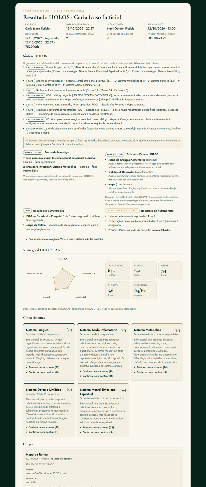 | 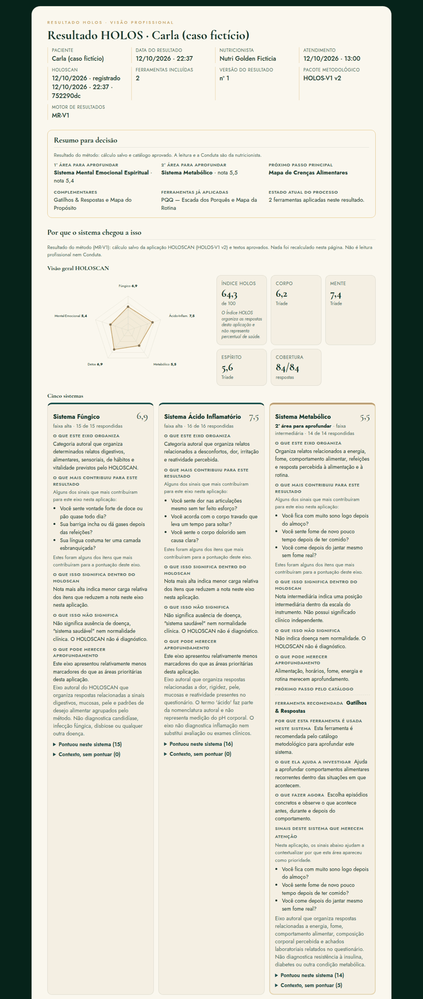 |
| Paciente | 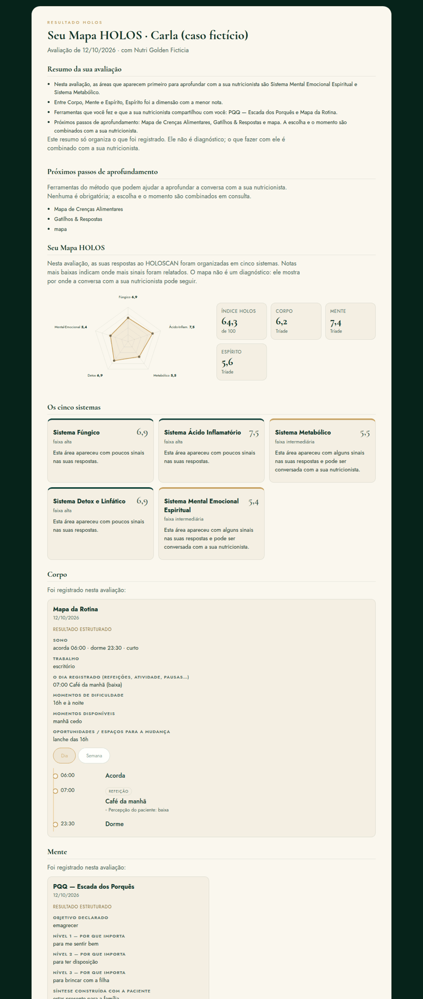 | 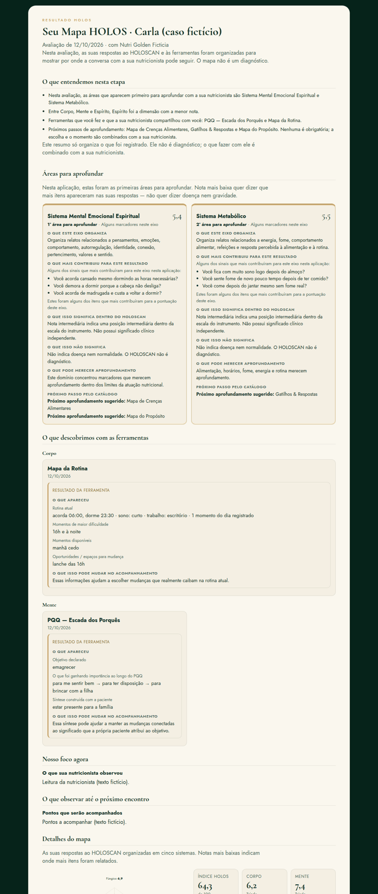 |

As 6 perguntas de aceite da paciente:

| Pergunta | Onde se responde |
|---|---|
| 1. O que apareceu no meu mapa? | O que entendemos nesta etapa e Áreas para aprofundar |
| 2. O que significa? | Blocos "O que este eixo organiza", "O que isso significa", "O que isso não significa" |
| 3. Por que fizemos as ferramentas? | Próximo aprofundamento sugerido, quando compartilhado, e "O que descobrimos" |
| 4. O que aprendemos? | Resultado de cada ferramenta compartilhada |
| 5. Onde focamos? | Nosso foco agora |
| 6. O que ficou combinado? | O que ficou combinado |

---

**PARE PARA HOMOLOGAÇÃO.** Para seguir:
1. Revisar os textos e as pendências (Q).
2. Aplicar as 3 partes SQL no banco real.
3. Fazer o deploy do front e conferir os hashes.

---

## T. FECHAMENTO DE HOMOLOGAÇÃO (13/10)

Rodada curta, antes do SQL e do deploy.

O que **não** mudou nesta rodada:
- HOLOS-V1 v2, as 84 perguntas, pesos, associações, cálculo, Índice, Tríade, faixas e cobertura;
- HOLOSCAN v3;
- PP-V1 e as 30 regras;
- exames, SNT-210 e SNT-309 (continuam pendentes para a revisão do pacote);
- Conduta como entidade;
- HOLOS AI (além das minimizações já feitas);
- dados históricos.

Também não houve SQL no banco real nem deploy.

### Decisões homologadas

| Decisão | Comportamento final |
|---|---|
| Detox + Linfático prioritário | Texto homologado, com a ressalva sempre junto, nas visões profissional e da paciente. A pendência saiu |
| Sistemas não prioritários | Frase transversal homologada para os cinco sistemas quando o sistema não está entre as duas primeiras áreas. Cálculo e prioridade não mudam |
| Mapa do Propósito | Só "O que eu quero" (OQ³), "Por que isso importa" (PQQ) e "O que consigo sustentar agora" (OQ³), mais as referências às aplicações fonte. **Sem bloco "Direção desta etapa"** |
| Pendências metodológicas | Informação interna da visão profissional. Nunca aparecem para a paciente |

**Mapa do Propósito.** Não há regra homologada para "Direção desta etapa", então o bloco não é mostrado. A ausência continua como pendência interna. O dado `derivados.mapa_proposito.campos.direcao` (o objetivo do PQQ) continua no snapshot só como dado de origem: não é exibido nem interpretado.

**Pendências metodológicas.** Na visão profissional ficam recolhidas e marcadas ("PENDÊNCIA METODOLÓGICA", "Pendências metodológicas"). O teste varre as superfícies da paciente com Momentum e Gatilhos, que sempre carregam pendência:
- visão da paciente;
- Resultado e PDF da paciente;
- mensagem do WhatsApp;
- relatório para o paciente.

**Texto final Detox + Linfático:**

> "Quando este eixo aparece entre as primeiras áreas para aprofundar, vale observar como funcionamento intestinal, retenção percebida, alimentação, hidratação, movimento e organização da rotina aparecem no contexto real da paciente."
>
> "Esse resultado não mede toxinas, capacidade de detoxificação, função hepática ou fluxo linfático."

O teste confirma que o texto não usa "acúmulo de toxinas" nem "detox ruim", não infere disfunção e não traz recomendação nutricional. A ressalva é uma negação homologada, por isso fica fora da busca de linguagem proibida, como o bloco E.

**Frase dos sistemas não prioritários:**

> "Este eixo apresentou relativamente menos marcadores do que as áreas prioritárias desta aplicação."

**Continuam pendentes, sem texto genérico:**
- significado das 10 ferramentas;
- estados do Momentum;
- ponto de intervenção de Gatilhos;
- PP-V2;
- ferramenta → ferramenta;
- integração Corpo/Mente/Espírito;
- resultado → Conduta.

### Arquivos alterados

**Commit A (textos):**
- `sistemas-fechamento.js`
- `ferramentas-fechamento.js`
- `resultado-sintese.js` (texto da PM-17)
- `style.css` (`.sf-ressalva`)
- `docs/deploy.md` (hashes)
- `testes/testar-sistemas-fechamento.mjs`
- `testes/testar-ferramentas-resultado.mjs`
- `testes/testar-relatorios-motor.mjs`

**Commit B (timezone):**
- `testes/relogio.mjs` (novo)
- `testes/testar-fuso-virada.mjs` (novo)
- `testes/testar-v1-etapa1.mjs`
- `testes/testar-auditoria-agenda.mjs`
- `testes/suites.mjs`

**Commit C:**
- este documento
- `docs/v1/motor-resultados/final/` (capturas e PDF)

### Correção de timezone (commit B, só testes)

**Causa.** O app interpreta a data e a hora do atendimento no fuso de quem atende (`profiles.fuso`, padrão America/Sao_Paulo, em `atendimento.js`), e esse comportamento está correto. As duas suítes:
- rodavam o Chrome no fuso do container (UTC);
- calculavam "hoje" com o relógio UTC do Node.

Entre 21h e 24h de Brasília a data UTC já é o dia seguinte. O app sugeria 12/10 (certo) e o teste esperava 13/10.

**Correção.** O código de produção não mudou, porque não havia defeito nele.
- O navegador do teste roda no fuso da clínica.
- O relógio fica fixado num instante conhecido: ontem, 22h30 de Brasília, quando o UTC já está no dia seguinte.
- Assim a janela 21h–24h é exercitada em toda execução, a qualquer hora.
- Não há horas fixas somadas e nenhuma falha é mascarada.

**Teste novo `testar-fuso-virada` (15 asserções):**
- 20h59, 21h00, 21h30, 23h59 e 00h30 de Brasília;
- "hoje" da agenda e a data/hora sugerida para o atendimento são o dia local;
- `occurred_at` é guardado como instante absoluto (21h30 = 00h30Z do dia seguinte) e lido de volta no dia e na hora locais;
- com o navegador em UTC e o perfil em Brasília, o atendimento continua no dia local da clínica.

**Observação, sem mudança.** O "hoje" da Agenda (`hojeISO`) segue o relógio do navegador. A data do atendimento segue o fuso do perfil. Os dois coincidem quando o navegador da nutricionista está no fuso do perfil, que é o caso padrão.

### Suíte e cadeia

| Verificação | Resultado |
|---|---|
| Suíte completa JS/browser | **VERDE: 146 suítes, 4406 asserções, 0 falhas, 0 reprovadas.** Rodada às 23h de Brasília, dentro da janela que antes falhava |
| Incluídos na suíte | testes do MR-V1, emissão imutável, Resultado da paciente e profissional, PDF/relatórios, Conduta por atendimento e timezone |
| Cadeia Postgres local | **449 ok, 0 FALHOU** (MR01–MR07) |

### Capturas finais

Caso fictício "Carla Ficticia", gerado pelo fluxo real no servidor falso:
- as respostas fictícias do HOLOSCAN seguem uma regra determinística única para as 84 perguntas;
- notas, Índice e Tríade foram **calculados pelo motor oficial**, sem nada ajustado à mão: Detox 4,7 · Ácido-Inflamatório 5,2 · Metabólico 5,2 · MEE 5,3 · Fúngico 6,4 · Índice 53,7;
- PQQ e Mapa da Rotina foram feitos;
- o Resultado foi salvo pela RPC;
- há uma Conduta fictícia no atendimento.

| # | Captura |
|---|---|
| 1 | 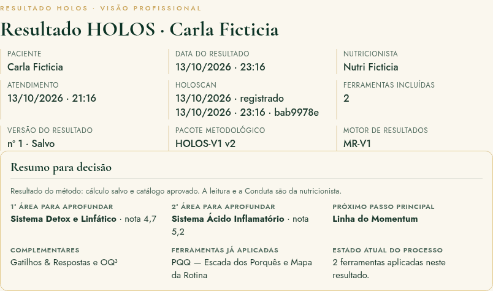 Profissional — topo (resumo para decisão primeiro) |
| 2 | 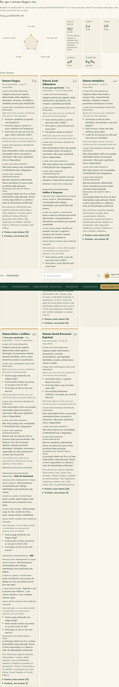 Profissional — cinco sistemas |
| 3 | 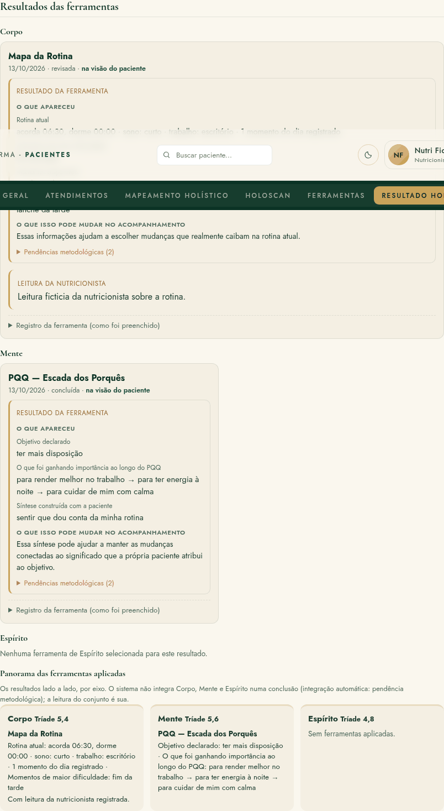 Profissional — ferramentas |
| 4 | 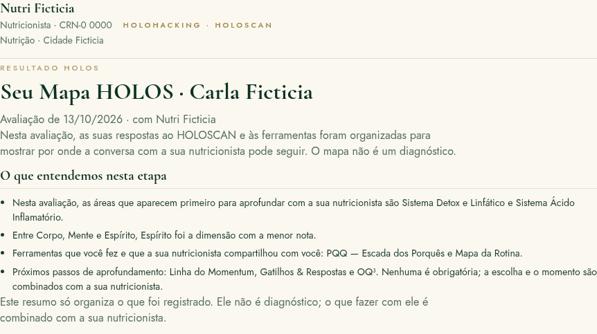 Paciente — topo |
| 5 | 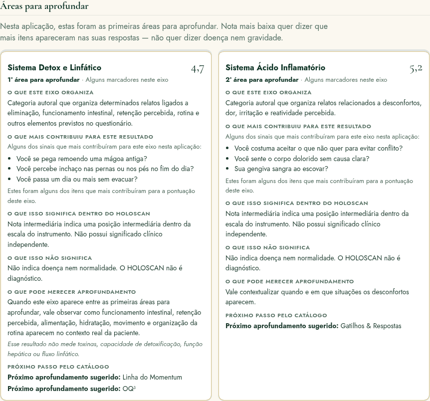 Paciente — áreas para aprofundar (Detox com o texto homologado e a ressalva) |
| 6 | 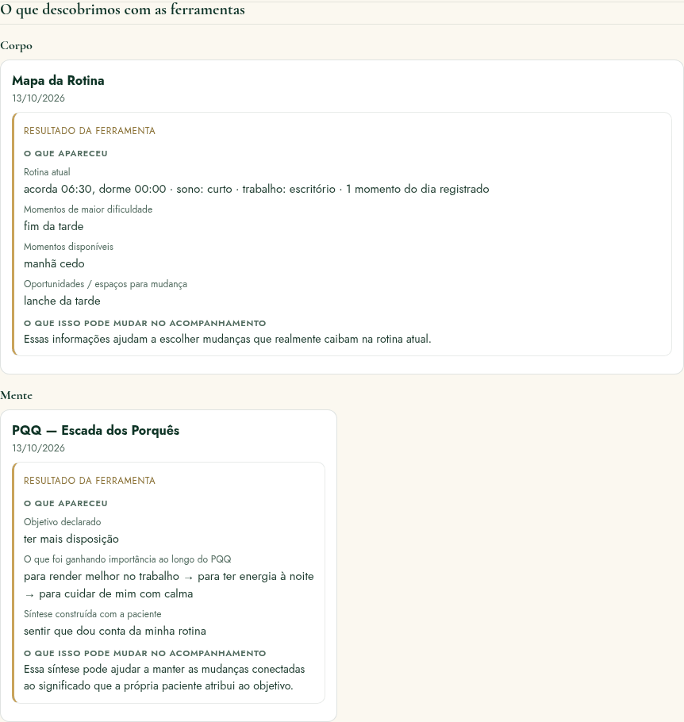 Paciente — ferramentas |
| 7 | 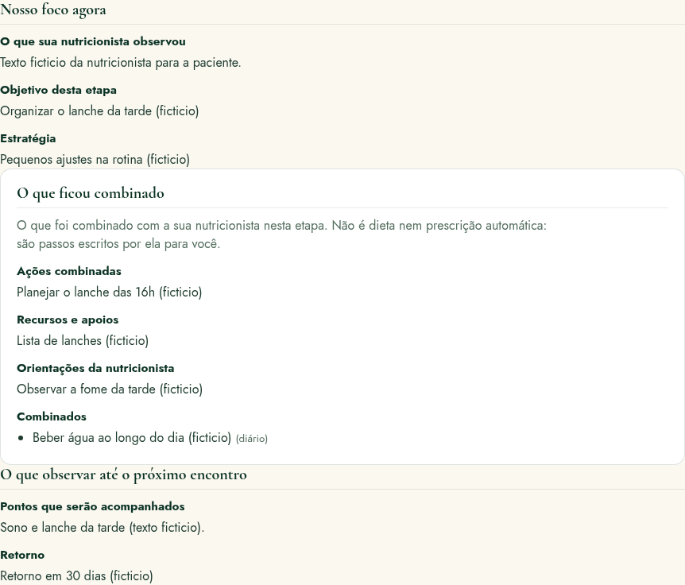 Paciente — Conduta / combinado |
| 8 | 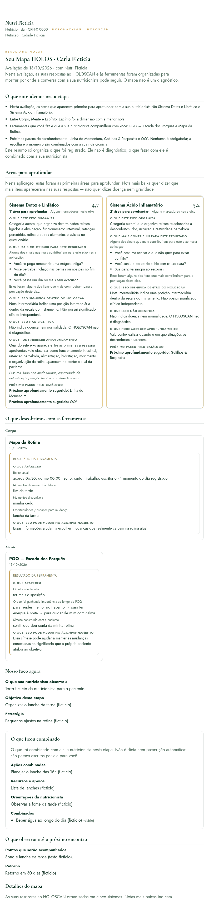 PDF da paciente — visão geral (o arquivo está em `final/8-pdf-paciente.pdf`) |

### Checklist de homologação visual

Conferido nas capturas e, de forma automática, no texto das duas visões:

| Item | Situação |
|---|---|
| Conclusão antes da evidência | ok |
| 1ª e 2ª área claras | ok |
| O que cada sistema representa | ok |
| Nota não é diagnóstico | ok |
| Índice com aviso anti-percentual | ok |
| Sem "faixa baixa" como mensagem | ok |
| Sinais com as perguntas oficiais | ok |
| Ferramenta sugerida com motivo | ok |
| Resultado ≠ registro da ferramenta | ok |
| Leitura da nutricionista separada | ok |
| Conduta separada | ok |
| Nenhuma pendência para a paciente | ok |
| Sem nomes de terceiros | ok |
| Sem a Carta integral | ok |
| PDF sem grandes vazios | ok |
| Rodapé só no final | ok |

### Commits

| Commit | Conteúdo |
|---|---|
| `99182b6` | A: homologação textual |
| `78f23f5` | B: timezone e testes (técnico, separado) |
| (este) | C: capturas e documentação final |

**git diff --stat `cb72230..HEAD` (A e B):** 13 arquivos, +173 / −27. O commit C soma este documento e `docs/v1/motor-resultados/final/`.

**PARE PARA HOMOLOGAÇÃO.** Nada foi aplicado no banco real e não houve deploy. A ordem autorizada depois da revisão:
1. SQL PARTE 1 → 2 → 3;
2. deploy;
3. teste da Carla fictícia no ambiente real;
4. homologação visual;
5. PP-V2.

---

## U. RODADA FINAL DE UX E CONTEÚDO DO RESULTADO DA PACIENTE (13/10, antes do deploy)

Nesta rodada mudaram só a apresentação, a linguagem e o PDF. **Não mudaram:**
- cálculo do HOLOSCAN, notas, faixas, Índice e Tríade;
- sinais dominantes, PP-V1, catálogo e ferramentas;
- Conduta, banco e metodologia.

Também não houve SQL nem deploy.

| # | Pedido | Feito |
|---|---|---|
| 1 | Frase das notas baixas | "Notas mais baixas indicam maior carga dos marcadores considerados neste eixo nesta aplicação. Isso ajuda a mostrar onde pode valer a pena aprofundar a conversa e não representa doença, gravidade ou diagnóstico." Aparece em "Áreas para aprofundar" e em "Detalhes do mapa". |
| 2 | Aviso antes dos sinais dominantes (paciente) | Texto literal antes da lista. Na visão profissional, nada mudou. |
| 3 | Tríade fora de "O que entendemos nesta etapa" | Saiu do resumo da paciente e continua em "Detalhes do mapa". |
| 4 | Próximos aprofundamentos | Título "Possíveis próximos aprofundamentos", com "Principal:" em negrito e "Outra possibilidade:" em tamanho menor, mais "A escolha do que aplicar e em qual momento é feita com sua nutricionista." A visão profissional mantém o catálogo/rank. |
| 5 | "Por que usamos esta ferramenta" | Aparece antes de "O que apareceu", só no Mapa da Rotina e no PQQ, com os textos homologados (`FerramentasFechamento.POR_QUE_USAMOS`). As outras ferramentas ficam sem o bloco. |
| 6 | Linguagem | "Este eixo reúne…" e "Essa nota, sozinha, não indica uma condição de saúde." A visão profissional mantém o texto técnico. |
| 7 | Menos repetição | Cartão completo só nas 2 áreas prioritárias. "Detalhes do mapa" mostra os 5 sistemas em cartão compacto: nome, nota, marcadores e definição curta. |
| 8 | PDF | Ver abaixo. |
| 9 | 5–6 páginas | **5 páginas** nos dois caminhos (antes, 10). |

### Correções do PDF

**Imprimir**
- **Causa da sobreposição no fim (o rodapé da nutricionista caindo sobre o cartão MEE):** o app ficava invisível (`visibility:hidden`), mas continuava ocupando espaço, e o documento era posto por cima com `position:absolute`.
- **Correção:** o documento é copiado, sem ids, para `#rp-impressao`, filho direto do `body`. O resto do app sai com `display:none`.

**Baixar PDF (html2pdf)**
- **PDF em branco quando a página estava rolada:** corrigido com `scrollX/scrollY: 0`.
- **Radar ausente:** html2canvas desenha o SVG sem o CSS da página. As cores e o tamanho agora vão na cópia que ele monta (`onclone`); o documento da tela e o HTML da emissão não mudam.
- **Cartões desalinhados:** o espaçador de quebra de página do html2pdf não pode cair dentro de uma grade. Por isso as grades inteiras são o elemento evitado, e as listas de cartões viram fluxo comum só durante a geração.
- **Moldura grossa:** os cantos ficam retos só no PDF baixado.
- **Marcadores de lista:** viram um caractere comum.

**Regras comuns aos dois caminhos**
- Seções e cartões grandes podem quebrar entre blocos; só blocos pequenos ficam inteiros.
- A lista "o que mais contribuiu" quebra entre itens.
- O título fica com o primeiro bloco.
- No papel, o Índice ocupa uma linha e as três notas da Tríade ficam lado a lado.
- O radar ficou maior, com rótulos legíveis.

**Conferência manual de todas as páginas.** Os dois PDFs da Carla fictícia foram rasterizados e conferidos página a página:
- 5 páginas em cada caminho;
- sem sobreposição;
- sem título sozinho no fim de página;
- sem página quase vazia;
- rodapé só no final.

Arquivos em `docs/v1/motor-resultados/ux-final/`:
- `pdf-paciente-baixado.pdf`
- `pdf-paciente-impresso.pdf`
- `pdf-*-todas-as-paginas.png`
- capturas 1–8

### Testes
- **Novo:** `testes/testar-resultado-ux-paciente.mjs`. Cobre os itens 1–8 e 11, com a visão profissional inalterada; a impressão real gera o documento inteiro.
- **Ajustados aos textos novos:**
  - `testar-correcoes-jornada`
  - `testar-motor-resultados`
  - `testar-relatorios-motor`
  - `testar-resultado-final`
  - `testar-resultado-sintese`
  - `testar-sistemas-fechamento`
  - `testar-ferramentas-resultado`
- **Hashes:** `docs/deploy.md` §3.5 regenerado (6 arquivos mudaram).

**PARE PARA HOMOLOGAÇÃO VISUAL FINAL.** Nenhum SQL foi aplicado e não houve deploy.
