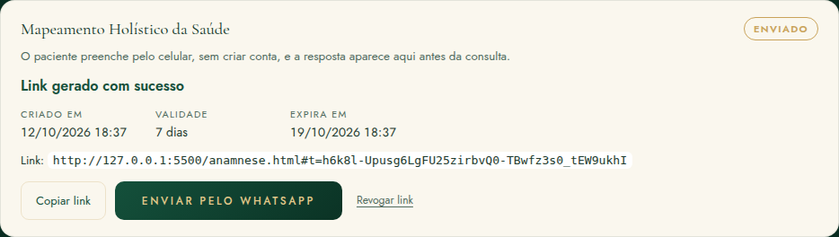
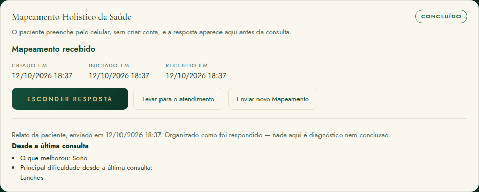

# Mapeamento Holístico da Saúde — correção do envio do link (12/10)

Na ficha, o botão de gerar o link da anamnese pré-consulta criava o convite, mas a tela não avançava e o link não aparecia. Esta correção foi feita só no navegador.

**O que não mudou:**
- banco real, migration, RPC, grant e política;
- perguntas e metodologia;
- design;
- deploy (não houve).

Na interface, o nome passa a ser **Mapeamento Holístico da Saúde**. Os nomes técnicos (tabela `anamnesis_invites`, RPCs, arquivos e campos) continuam os mesmos.

## 1. Causa exata

| | |
|---|---|
| Onde | `anamnese-convite.js`, função `carregar`: `select("*")` em `anamnesis_invites` |
| Por que falha | O banco real dá SELECT ao usuário logado **coluna a coluna**, sem `token_hash` (migration `20261014100000`, linhas 97–99). O PostgREST troca `*` pela lista de **todas** as colunas, inclusive `token_hash`. O Postgres recusa a consulta inteira: `42501 permission denied for table anamnesis_invites` |
| Conferido no banco real (só leitura) | `authenticated` não tem SELECT na tabela, só nas 19 colunas, sem `token_hash` |
| Provado no Postgres local | harness **AP18**: `select *` recusado (42501); colunas explícitas aceitas; `token_hash` ilegível |
| Por que os testes não pegaram | o Supabase falso aceitava `*`. Agora ele recusa como o banco real |

**O que acontecia ao clicar:**
1. A RPC `criar_convite_anamnese` criava o convite e devolvia o token.
2. A ficha guardava o link.
3. A releitura falhava com 42501, e a lista ficava vazia.
4. O cartão voltava para "Não enviada", com "Gerar link" e sem link nenhum.
5. Ao recarregar a ficha, o erro de leitura impedia ver qualquer convite, inclusive os concluídos.

## 2. Fluxo anterior e fluxo corrigido

| Passo | Antes | Agora |
|---|---|---|
| Ficha → aba Anamnese → `#an-preconsulta` | `PreConsulta.desenhar` (`anamnese-convite.js`) | igual |
| Leitura dos convites | `select("*")`, recusada no banco real | `select(COLUNAS)`: 15 colunas explícitas, **sem `token_hash`** |
| Se a leitura falha | a lista era apagada | a lista atual é mantida e o erro aparece no cartão |
| Botão | "Gerar link" | **"Enviar Mapeamento Holístico"** (`data-pc-acao="gerar"`) |
| Função | `gerar()` | `gerar()`, que agora não dispara duas vezes |
| RPC | `criar_convite_anamnese(p_patient_id, p_encounter_id, p_dias=7, p_tipo, p_logo)` | igual |
| Retorno da RPC | `{ id, token, expires_at, status, form_tipo }` | igual; o token é validado (40 a 64 caracteres base64url) |
| URL | `location.origin + "/anamnese.html#t=" + token` | igual |
| Tela depois de gerar | dependia da releitura, que falhava | o convite devolvido pela RPC entra na tela na hora. A releitura só atualiza |
| Revogar | dependia da releitura | marca "Revogado" na hora; a releitura só atualiza |

**O cartão depois de enviar:**
- "Link gerado com sucesso", status **Enviado**;
- Criado em, Validade (7 dias) e Expira em;
- o link completo;
- os botões Copiar link, Enviar pelo WhatsApp e Revogar link.

## 3. Token e segurança (sem mudança no banco)

- **Geração:** o token é gerado no servidor (32 bytes aleatórios, 43 caracteres base64url). O banco guarda só o `sha256`.
- **Uso:** o token puro só vem na resposta da criação. A ficha guarda o link em memória, só nesta sessão.
  - Ao recarregar, o link não volta: só existe o hash. O cartão mostra "Gerar novo link", e o anterior é revogado.
  - Também não há botão de copiar com link vazio.
- **Onde fica o token no link:** depois do `#`. Assim ele não vai para o servidor web nem para os logs.
- **`token_hash`:** continua sem grant e o front não o pede. O teste confere que o arquivo não tem `select("*")` nem `token_hash`.
- **Página pública:** usa só as 3 RPCs públicas (`anamnese_publica_abrir`, `_salvar`, `_enviar`).
- **Isolamento:** outra nutricionista não lê, não cria e não revoga convites que não são dela (RLS e RPCs, sem mudança).

## 4. Copiar e WhatsApp

**Copiar link:**
- Usa a área de transferência. Se o navegador recusar, tenta a cópia antiga (`execCommand`); se também falhar, abre uma caixa com o link para copiar.
- Avisa "Link copiado.".
- Só copia um link no formato `/anamnese.html#t=<token>`. Link vazio ou incompleto não é copiado.

**WhatsApp:**
- Usa o telefone salvo do paciente, normalizado pela mesma regra do Resultado (`ResultadoPagina.numeroWhatsApp`):

| Telefone salvo | Número usado |
|---|---|
| `(62) 98888-7777` | `5562988887777` |
| `+55 62 97777-6666` | `5562977776666` (sem 55 em dobro) |
| `5562966665555` | `5562966665555` |
| sem telefone | o WhatsApp abre para escolher o contato, com aviso |

- Mensagem: "Olá, [primeiro nome]. Antes da nossa consulta, peço que preencha o seu Mapeamento Holístico da Saúde pelo link abaixo: [link] As informações serão utilizadas para preparar seu atendimento."
- A mensagem não leva sobrenome nem nenhuma informação clínica.

## 5. Estados

| Estado | Quando |
|---|---|
| Não enviado | sem convite |
| Enviado | convite criado |
| Iniciado | o paciente abriu e o rascunho foi salvo |
| Concluído | o paciente enviou: aparece **"Mapeamento recebido"**, Recebido em, Ver resposta e Levar para o atendimento |
| Expirado | o prazo de 7 dias passou |
| Revogado | revogado ou trocado por um novo link |

A ficha mostra o estado do servidor ao ser aberta ou recarregada.

## 6. Levar para o atendimento (sem mudança na regra)

- Exige um atendimento ativo **sem** anamnese. Se o atendimento já tem anamnese, recusa: não sobrescreve.
- Cria **um** rascunho V2 com origem `relato_paciente`. A RPC `marcar_convite_anamnese_usado` registra o uso.
- Depois disso, o botão some e a ficha mostra "Levado para o atendimento em …".
- Tentar levar de novo é recusado, sem duplicar.
- A resposta original (`submitted_content`) não muda.

## 7. Textos trocados (só interface)

| Antes | Agora |
|---|---|
| Anamnese pré-consulta (ficha, título e cabeçalho da página pública) | Mapeamento Holístico da Saúde |
| Gerar link | Enviar Mapeamento Holístico |
| Anamnese recebida (etapa do Dashboard) | Mapeamento recebido |
| Levar para a anamnese do atendimento | Levar para o atendimento |
| Revogar | Revogar link |
| Não enviada / Enviada / Iniciada / Concluída / Expirada / Revogada | Não enviado / Enviado / Iniciado / Concluído / Expirado / Revogado (concordam com "Mapeamento") |

**Não trocados nesta tarefa** (não estavam na lista):
- na página pública: "Enviar anamnese" e "Anamnese enviada!";
- no Dashboard: a etapa "Aguardando anamnese";
- na resposta: "Relato da paciente".

## 8. Arquivos

| Arquivo | O que mudou |
|---|---|
| `anamnese-convite.js` | colunas explícitas; leitura que não apaga a tela; convite novo na tela na hora; revogar local; copiar com reserva; WhatsApp com a mensagem e o número normalizados; textos |
| `anamnese.html` | título e cabeçalho |
| `anamnese.js` | uma mensagem |
| `dashboard.js` | rótulo "Mapeamento recebido" |
| `style.css` | 2 regras: aviso de sucesso/recebido e rótulo "Status:" para leitor de tela |
| `testes/supabase-falso.mjs` | recusa `*` e `token_hash` em `anamnesis_invites`, como o banco real |
| `testes/testar-mapeamento-holistico.mjs` | novo, 30 verificações |
| `testes/testar-anamnese-pre-consulta.mjs`, `testes/testar-dashboard-acompanhamento.mjs` | textos novos |
| `supabase/tests/anamnese-pre-consulta-harness.sql` | AP18 |
| `docs/deploy.md` | hashes |

## 9. Migrations

Nenhuma, porque o banco já estava certo: o erro estava só na consulta da ficha. Não há preflight, SQL nem postflight a aplicar. Para publicar, basta o deploy dos arquivos acima, quando você autorizar.

## 10. Testes

**`testar-mapeamento-holistico.mjs` (30 verificações):**
- `*` e `token_hash` recusados; o fonte sem `select("*")`;
- a RPC devolve id, token e expires_at; uma linha criada; URL montada; só o hash no banco;
- o cartão depois de enviar e seus botões;
- copiar (normal e pela reserva); nenhum link vazio copiado;
- WhatsApp com telefone sem 55, com +55, com 55 e sem telefone; texto exato; sem dado clínico;
- releitura falhando depois de criar: o link fica na tela;
- recarregar: o link não volta e aparece "Gerar novo link";
- Iniciado → Concluído com "Mapeamento recebido";
- levar para o atendimento: sem atendimento ativo, com anamnese já existente, um rascunho só, o botão some, a resposta não muda, segunda tentativa recusada;
- outro paciente e outra nutricionista.

**`testar-anamnese-pre-consulta.mjs`** cobre a página pública:
- token válido, inválido (inventado ou com 1 caractere trocado), expirado, revogado e concluído;
- sem token;
- autosave; fechar e reabrir; outro aparelho;
- envio, com reenvio e novo salvamento recusados.

**Postgres local:** a cadeia completa tem 436 verificações ok, inclusive a AP18.

## 11. Riscos que continuam

- **Link só na sessão que o gerou:** se a nutricionista fechar a ficha antes de copiar, precisa gerar outro, e o anterior é revogado. É de propósito: o banco não guarda o token.
- **"Iniciado" e "Concluído":** aparecem quando a ficha é aberta ou recarregada. Não há atualização em tempo real.
- **Validação no banco real:** não houve, porque produção não foi alterada. A correção depende do deploy dos arquivos.
